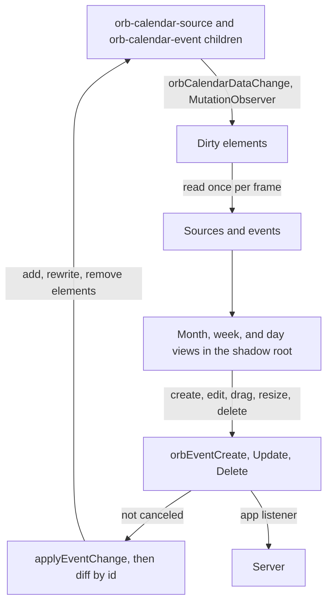
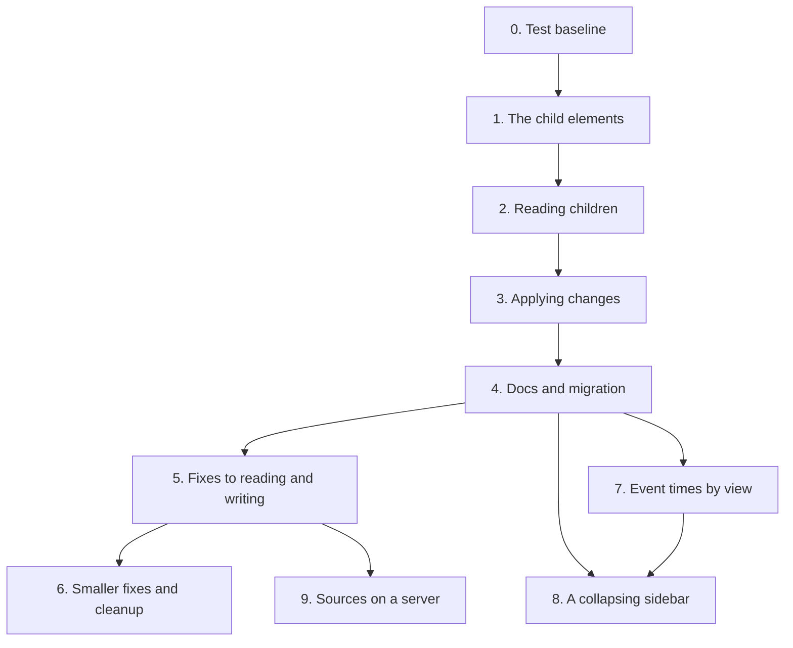

# `orb-calendar` driven by markup

## Requests

- make `orb-calendar` markup driven, the way `orb-channel` is
- replace the `calendars` and `events` props with child elements you put inside the calendar. They exist only so you don't need JavaScript to set data, and they don't need to render anything
- the calendar should apply the user's changes itself, so apps don't need event listeners or `applyEventChange` to keep it up to date
- keep the same event hooks (`orbEventCreate`, `orbEventUpdate`, `orbEventDelete`), so apps can copy the changes to their server

Follow-up, after Phase 4:

- fix every finding from the code review of the uncommitted work, including the minor ones and the cleanup
- when the calendar is too narrow for the sidebar, collapse it into an icon button that opens an `orb-menu` of checkbox items, one per source. No date picker in the menu. Decide with container queries, so a narrow calendar on a wide screen collapses too
- load events from a server with `orb-calendar-source`, in the style of `orb-channel-participant-source`
- week and month views show only the event's name. Day view shows its start and end times too, since it has the room

---

# Implementation plan

The files involved:

| File | What changes |
|---|---|
| `src/components/calendar-source/calendar-source.tsx` (new) | `orb-calendar-source`: a named calendar. Holds data and renders nothing. |
| `src/components/calendar-event/calendar-event.tsx` (new) | `orb-calendar-event`: one event. Holds data and renders nothing. |
| `src/components/calendar/utils/markup.ts` (new) | Reads children into `OrbCalendarSource` and `OrbCalendarEvent`, parses and formats times, and creates and writes event elements |
| `src/components/calendar/calendar.tsx` | Removes `events` and `calendars`. Reads its children, writes the user's changes back into them, and makes the change events cancelable. |
| `src/components/calendar/views/sidebar.tsx` | Toggling a calendar writes `hidden` on its source element |
| `src/components/calendar/utils/types.ts` | New `OrbCalendarChangeDetail`, plus `element` on `OrbCalendarEventClickDetail` |
| `src/components/calendar/utils/recurrence.ts` | No change in behavior. `applyEventChange` now also drives the calendar's own writes. |
| `src/index.ts` | Exports `createEventElement`, `applyEventChange`, `readEvent`, `readSource`, `writeEvent`, and the time helpers as `parseCalendarTime` and `formatCalendarTime`. |
| `src/components/calendar/calendar.md` | Rewritten around markup. Most demos have no script. |
| `src/components/calendar-source/calendar-source.md`, `calendar-event/calendar-event.md` (new) | Short pointers to the calendar docs, like `channel-participant.md` |
| `tests/calendar.spec.ts`, `tests/calendar-docs.spec.ts` (new) | No calendar tests exist yet. Phase 0 adds them. |

## Decisions

These are the choices the plan makes. Each one can be changed before work starts.

| Decision | Choice |
|---|---|
| Element names | `orb-calendar-source` and `orb-calendar-event`. "Source" matches the existing `OrbCalendarSource` type and avoids `orb-calendar-calendar`. |
| Rendering | Same as channel. Children use `shadow: true` and render an empty `<Host />`. The calendar's shadow root has no `<slot>`, so children never show. The calendar draws everything. |
| Child-to-parent updates | Same as channel. Children emit one bubbling, non-composed `orbCalendarDataChange` from a `@Watch` on every prop, and once from `componentDidLoad`. A `MutationObserver` on the calendar covers added and removed elements, title text, and attribute edits. |
| Which children count | Direct children only, as in channel. Frameworks render those directly. Wrapped or nested events are ignored. |
| Attribute names | The `OrbCalendarEvent` field names in kebab case (`calendar-id`, `all-day`, `recurrence-parent-id`), so JSON maps to markup mechanically. |
| Title | The event element's text. Stencil reserves `title` as a prop name, and the global `title` attribute shows a tooltip. Events hold only text. |
| Ids | The element's `id`, as with channel's participants and messages. Ids are page-wide, so two calendars on one page need different event ids. An event without an `id` is shown read-only, with a console warning: a read doesn't write an id, and a change can't be written without one. A source without an `id` is skipped, with a console warning. |
| Hidden calendars | The global `hidden` attribute on `orb-calendar-source`. Stencil reserves `hidden` as a prop name, so it's read with `hasAttribute` and observed by the `MutationObserver`. The sidebar checkboxes write it, so `hiddenOverrides` goes away. |
| Times in markup | `start`, `end`, `recurrence-id`, and `recurrence-exceptions` accept ISO 8601 with an offset (`2026-06-08T09:00Z`), without one (local time), a date alone (local midnight), or epoch ms (all digits). Forms without an offset are parsed by hand, as `fromInputValue` does, because `Date.parse` reads a date alone as UTC. |
| Times the calendar writes | Local time with its offset (`2026-06-08T10:00-04:00`), and a date alone for all-day events. That's readable, unambiguous, and keeps the wall clock. Seconds and milliseconds are written only when they aren't zero, so values round-trip exactly. `expandOccurrences` compares exceptions and overrides by exact ms. |
| Missing `end` | An all-day event lasts one day, and a timed event lasts an hour, the same as a new event made by clicking. |
| `date` on the calendar | Also accepts an ISO date, so a markup-only demo can open on a fixed week (`date="2026-06-08"`). Navigation still writes epoch ms, and `orbDateChange` still emits epoch ms. |
| Applying changes | Automatic. The calendar emits the event first, then writes the change into its children unless `preventDefault()` was called. |
| How changes are written | One path: run `applyEventChange` on the current events, read fresh from the children at write time, then diff by id. Ids that are gone lose their element, new ids get a new element, and changed ids get only the changed attributes rewritten. The recurrence rules stay in one place, and match what a server running the same function gets. |
| Event detail | `OrbCalendarMutation` stays as it is. The events' detail becomes `OrbCalendarChangeDetail`, which adds `element`: the new element for a create, otherwise the element of the event the user acted on. |
| New event ids | The calendar makes the id before it emits `orbEventCreate`, so `detail.event.id` is no longer `""`. The id combines the time and a counter, since `crypto.randomUUID()` needs a secure context. Apps can change `element.id` once their server answers. Overrides pointing at the old id follow it. |
| Generated ids | Overrides and splits keep `applyEventChange`'s formats (`master::start` and `master:start`), so a server running the same function gets the same ids |
| Canceling | `orbEventCreate`, `orbEventUpdate`, and `orbEventDelete` become cancelable. Canceling skips the write only. The editor still closes, so "save on the server first, then apply" works. A canceled drag snaps back. |
| Applying later | A new `applyChange(mutation, kind)` method writes a change exactly as the automatic path does, without emitting. It's for apps that cancel, wait for their server, then apply. |
| Frameworks | In an app that renders events from state (React, Vue), cancel the events and update the state, as with a controlled input. Otherwise the calendar and the framework both write the same elements. |
| `applyEventChange` | Still exported, but the docs now present it as the way to copy changes onto your own copy of the data, for example on a Node server. It's no longer needed to update the calendar. |
| `createEventElement` | Exported. It turns an `OrbCalendarEvent` into an element, for apps that load JSON (lazy loading, imports). The writer uses it too. |
| Tests | Playwright on **Chromium and WebKit only**, as for the grid, until the Firefox hang on the dev machine is fixed: `npx playwright test tests/calendar*.spec.ts --project=chromium --project=webkit`. |

## The markup

Today:

```html
<orb-calendar id="cal" view="week"></orb-calendar>
<script type="module">
  import { applyEventChange } from "orb-style";
  const cal = document.querySelector("#cal");
  cal.calendars = [{ id: "work", name: "Work", color: "primary" }];
  cal.events = [{ id: "standup", title: "Standup", start: 1780923600000, end: 1780925400000, calendarId: "work" }];
  cal.addEventListener("orbEventCreate", (e) => (cal.events = applyEventChange(cal.events, e.detail, "create")));
  cal.addEventListener("orbEventUpdate", (e) => (cal.events = applyEventChange(cal.events, e.detail, "update")));
  cal.addEventListener("orbEventDelete", (e) => (cal.events = applyEventChange(cal.events, e.detail, "delete")));
</script>
```

After:

```html
<orb-calendar view="week" date="2026-06-08">
  <orb-calendar-source id="work" name="Work" color="primary"></orb-calendar-source>
  <orb-calendar-source id="home" name="Home" color="success"></orb-calendar-source>
  <orb-calendar-event id="standup" calendar-id="work" start="2026-06-08T09:00" end="2026-06-08T09:30"
    recurrence="FREQ=WEEKLY;BYDAY=MO,TU,WE,TH,FR">Standup</orb-calendar-event>
  <orb-calendar-event id="lunch" calendar-id="home" start="2026-06-09T12:00" end="2026-06-09T13:00">Lunch</orb-calendar-event>
  <orb-calendar-event id="conf" calendar-id="work" start="2026-06-10" end="2026-06-13" all-day>Conference</orb-calendar-event>
</orb-calendar>
```

When the user drags Tuesday's standup to 10:00 and chooses This Event, the calendar adds an override after its master, and emits `orbEventUpdate` with the same detail as today:

```html
<orb-calendar-event id="standup::1781010000000" calendar-id="work"
  start="2026-06-09T10:00-04:00" end="2026-06-09T10:30-04:00"
  recurrence-parent-id="standup" recurrence-id="2026-06-09T09:00-04:00">Standup</orb-calendar-event>
```

Copying changes to a server is the listener, without the write:

```js
cal.addEventListener("orbEventUpdate", ({ detail }) => {
  fetch("/api/events/changes", { method: "POST", body: JSON.stringify({ kind: "update", ...detail, element: undefined }) });
});
```

### How data flows



## Phases at a glance

| Phase | Contents | Estimate (1 developer) |
|---|---|---|
| 0. Test baseline | `tests/calendar.spec.ts` covering `applyEventChange`, rendering, the editor, the scope prompt, drag, and ICS export with the current props | 1d |
| 1. The child elements | `orb-calendar-source`, `orb-calendar-event`, and `utils/markup.ts`: reading, time parsing and formatting, creating and writing elements | 1.5–2d |
| 2. Reading children | Removing `events` and `calendars`, the observer and flush, the sidebar writing `hidden`, `date` as a string. Done: also a fix in `orb-overlay`, which took two closes | 2.5d |
| 3. Applying changes | The writer, cancelable events, `element` in the detail, new ids, following id changes, `applyChange()` | 2–3d |
| 4. Docs and migration | `calendar.md` rewritten around markup, child docs, a docs spec, release notes | 1.5–2d |
| 5. Fixes to reading and writing | Review findings 1–8: numeric properties, the app's pending changes, comparing by meaning, writing properties, a fresh element map, `try/finally`, reconnecting, events without ids | 2–2.5d |
| 6. Smaller fixes and cleanup | Review findings 9–13, the cleanup list, spec types, unique ids in the docs, plan drift | 1–1.5d |
| 7. Event times by view | Names only in week and month, start and end in day, the time kept for screen readers | 0.5d |
| 8. A collapsing sidebar | A container query swaps the sidebar for an icon button and an `orb-menu` of sources | 1–1.5d |
| 9. Sources on a server | `href` on `orb-calendar-source`, loaded per visible range, cached, sanitized, cancelable | 2–3d |

**Total for 0–4: about 7.5–10 days. For 5–9: about 7–9 days.** Each phase ends with its tests and its part of `calendar.md`. Phase 2 removes the props, so it ships together with Phase 3. Between them, the calendar would show markup it can't save into.



Phase 9 needs Phase 5: it inserts children from outside the writer, so it relies on the writer taking in the app's pending changes, a fresh element map, and re-reading on reconnect. Phase 8 comes after 7 only because both touch the header and the views' CSS, so doing them in order avoids conflicts.

---

## Phase 0: Test baseline

There are no calendar specs, and Phases 2 and 3 replace how data gets in and how changes get out. Add a baseline first, so regressions show up. The assertions carry over. Only the setup changes from props to markup in Phase 2.

- `tests/calendar.spec.ts`, using `mount()` from `tests/utils.ts`. Pin `timezoneId: "America/New_York"` with `test.use()`, so DST cases are repeatable. Cover:
  - **`applyEventChange`**, imported with `await import("/dist/components/index.js")` as in `channel-ai.spec.ts`: create, then update and delete with each of `single`, `occurrence`, `future`, and `all`. Check the override id (`master::start`), the split id (`master:start`), `recurrenceExceptions`, the `UNTIL` on the old series, and the moved overrides after a split.
  - **Rendering** in week view: a timed event, an all-day bar, a recurring event's occurrences, an override replacing one occurrence, and an exception skipping one. Count `[part~="event"]` in the shadow root.
  - **Sources**: an event takes its source's color. Unchecking a source in the sidebar hides its events.
  - **Editor**: clicking an empty slot and saving emits `orbEventCreate` with the slot's start and an hour's duration. Clicking an event and deleting emits `orbEventDelete`.
  - **Scope prompt**: saving an edit to a recurring occurrence asks first. This Event emits `scope: "occurrence"` with `occurrenceStart`, and dismissing emits nothing.
  - **Drag**: dragging a timed event down one hour emits `orbEventUpdate` with both times 60 minutes later. `editable="false"` and `readonly` events don't move.
  - **`orbEventClick`**: `preventDefault()` keeps the editor closed.
  - **`exportICS()`**: contains `RRULE`, `EXDATE`, and `RECURRENCE-ID`.
- Add a comment at the top of the spec saying Firefox is skipped for now and why.

### Status: done

`tests/calendar.spec.ts` has 56 specs, in eight blocks. It runs 208 times across Chromium and WebKit, twice each, and passes: 208 passed, 4 skipped (one `test.fixme` per browser). The rest of the suite passes in Chromium too, and `tsc` is clean. The skipped one is explained below.

What the implementation found:

- **Times in the spec must be built in the browser's zone.** The runner here is in `America/Chicago`, and `test.use({ timezoneId })` sets the browser only, so a `new Date(...)` at the top of the file, or in a test, isn't the browser's local time. The spec sets `process.env.TZ = "America/New_York"` before `test.use`, so the runner and the browser agree, and builds every date with a `date(day, hours)` helper. Phase 2's round-trip tests need the same, or the fixture and the assertion drift by an hour. Expect this on other machines too. It isn't a calendar bug, but a spec written without it fails in ways that look like calendar bugs.
- **`applyEventChange`, `all` scope**: the master moves by (the change's start − the occurrence's start), which is a day at the same hour in the specs. Its rule keeps its start time.
- **`future` scope**: the `UNTIL` ends a second before the occurrence, written as the wall clock's fields in UTC (`FREQ=DAILY;UNTIL=20260609T085959Z` for a 9:00 occurrence on June 9 in New York). That's the format Phase 3's writer must use.
- **Month ranges**: whole weeks from the 1st to the last day of the month, ending at 23:59:59.999 of the last Saturday. June 2026 is 5 weeks (35 cells), not 6, and its range starts on May 31.
- **Recurring blocks** show `data-occ-start` as the occurrence's start, per the series' own datetimes. A daily event starting Tuesday 9 shows 9 on each day.

The tests turned up two bugs and one rough edge. The first is fixed, the second doesn't happen any more, and the third is recorded as a `test.fixme` so it doesn't go away unnoticed when Phase 3 rewrites the writes:

1. **Changing a repeat preset to Custom didn't work. Fixed.** "Custom…" showed as "Every Week", and its own fields never appeared, so a rule couldn't be set from the picker. Two things were wrong, and my first two diagnoses were wrong too:
   - The editor worked out which preset was chosen by looking at the event's rule (`presetFor(recurrence)`). "Custom" writes the rule the event already has, or `FREQ=WEEKLY` when it has none, and the weekly rule is the "Every Week" preset. So after picking Custom, the rule said "weekly", and the picker drew "Every Week". The choice can't be read back from the rule in the case Custom exists for.
   - The picker's `selected` attributes are the only thing showing the choice, and they're rewritten on the same `<select>` each render. That works for the other presets, and stopped mattering once the choice was state.
   The fix: the calendar keeps `editorPreset`, the preset the user picked, next to the draft. It's set by `pickPreset()`, which also writes the rule, and cleared when the editor opens or closes. The editor takes it as `preset` and falls back to reading the rule only when nothing was picked. `ruleFor()` lives in `event-editor.tsx` and is shared, so "Custom" keeps whatever rule the event had, which is what it did before. The behavior is covered by two specs: Custom after a preset keeps that preset's rule, and Custom on a new event shows Custom's fields and starts on Weekly.
2. **The editor's Toggle losing its edit the second time: not reproducible any more.** Before the fix in 1, a sequence that toggled all-day, saved, reopened, and toggled back recorded `allDay: true` for the second save. That can't happen now, and I couldn't make it happen: four toggles back to back, three times each, in Chromium and WebKit, record true, false, true, false, with an app applying each change as the docs' quickstart does. The most likely reason is that it was the same stale-render problem as 1: the editor read its draft at render time, and a render that arrived with an old draft wrote the old value. Both bugs turned up on the same build, and 1's fix removed the shared cause. There's a spec for the sequence now, "All-day toggles back and forth, saved each time".
3. **Dismissing the prompt leaves the editor open behind it** (a `test.fixme`). Escape closes the prompt, and nothing is saved, but the editor stays, so a second Escape closes the prompt again. Closing the editor when the prompt is dismissed is a small change to `save()` for the docs phase, if it should work that way.

The scope prompt does dismiss on Escape, which was checked on its own and inside the calendar, in Chromium and WebKit, so no overlay change is needed. A spec covers it: Escape closes the prompt, emits nothing, and leaves the editor open behind it, which is finding 3 above.

An earlier version of this status said the prompt couldn't be dismissed, because the specs saw its panel stay after Escape. The fault was in the specs, not the overlay. They found the prompt's panel through `orb-overlay`'s shadow root, which a locator can't see into, so they matched nothing and read "gone", or matched the editor. Meanwhile the prompt really did close and then reopen, because the editor behind it stays open and focused, and a second attempt at saving asks again. The specs now read the overlay's own `open` state from the page, and wait for the prompt to close.

---

## Phase 1: The child elements

### `orb-calendar-source`

| Attribute | Field | Notes |
|---|---|---|
| `id` | `id` | Read from the element, not a prop. Stencil reserves `id`. |
| `name` | `name` | Shown in the sidebar |
| `color` | `color` | Token, token and shade, or any CSS color, as today |
| `hidden` | `hidden` | The global attribute, read with `hasAttribute`. Not a prop. Harmless on an element that renders nothing. |

### `orb-calendar-event`

| Attribute | Field | Notes |
|---|---|---|
| `id` | `id` | Read from the element. Without one, the event is read-only (see Decisions). |
| text content | `title` | Trimmed |
| `start` | `start` | Required. An event without a valid `start` is skipped, with a console warning naming it. |
| `end` | `end` | Exclusive. Optional (see Decisions). |
| `all-day` | `allDay` | Boolean |
| `calendar-id` | `calendarId` | A source's `id` |
| `location`, `notes`, `url` | same | `notes` can span lines, since attribute values keep newlines |
| `color` | `color` | Overrides the source's color |
| `readonly` | `readonly` | Boolean |
| `recurrence` | `recurrence` | RRULE without `RRULE:` |
| `recurrence-exceptions` | `recurrenceExceptions` | Times separated by spaces |
| `recurrence-parent-id` | `recurrenceParentId` | On an override |
| `recurrence-id` | `recurrenceId` | On an override: the start it replaces |

### Changes

1. **Two components**, each in its own folder like the channel children, built like `channel-participant.tsx`:
   - `shadow: true`, `render() { return <Host />; }`.
   - `@Event({ bubbles: true, composed: false }) orbCalendarDataChange: EventEmitter<void>`, emitted from `componentDidLoad()` and from one `changed()` method with a `@Watch` for every prop.
   - JSDoc on every prop. Time props are typed `string | number`, so `el.start = Date.now()` type-checks.
2. **`utils/markup.ts`**:
   - `read()`, `flag()`: a prop if the child has upgraded, else its attribute. The same helpers as `channel/model/parse.ts`, copied rather than shared, to leave channel alone. Sharing them can come later.
   - `parseTime(value, allDay)`: digits are epoch ms. `YYYY-MM-DD` is local midnight. `YYYY-MM-DDTHH:mm[:ss[.SSS]]` without an offset is local, built with `new Date(y, m, d, h, mi, s, ms)`. Anything with `Z` or an offset goes to `Date.parse`. Returns `undefined` when invalid.
   - `formatTime(epoch, allDay)`: the format from Decisions.
   - `readSource(el)` and `readEvent(el)` return the existing `OrbCalendarSource` and `OrbCalendarEvent` types, so the views, layout, recurrence, and ICS code don't change.
   - `createEventElement(event, doc = document)`: a detached `orb-calendar-event` with only the attributes that have values.
   - `writeEvent(el, event)`: sets each attribute whose formatted value differs, removes attributes whose field is `undefined`, `""`, `false`, or an empty list, and sets `textContent` only when the title changed. It writes attributes, not props, so it works before the child upgrades and the markup stays the saved state (`cal.innerHTML` round-trips).
3. **Before upgrade**: the calendar's shadow root has no slot, so titles are hidden once the calendar upgrades. Check the demos for a flash of title text before that. Channel has the same exposure and no rule for it. Only if it shows, add `orb-calendar:not(:defined) > * { display: none; }` to the global styles.

### Tests

- Round trips in New York, including a DST change: `formatTime(parseTime(x))` for timed, all-day, with seconds, and with ms. `parseTime("2026-06-08")` is local midnight, not UTC midnight.
- `parseTime` accepts `Z`, `+02:00`, no offset, and epoch ms, and rejects junk.
- `readEvent` before and after upgrade gives the same object. A missing `end` gets the default duration.
- `createEventElement(readEvent(el))` matches `el`'s attributes. `writeEvent` with the same event changes nothing (check with a `MutationObserver` that records zero mutations).

### Status: done

`src/components/calendar-source/`, `src/components/calendar-event/`, and `src/components/calendar/utils/markup.ts`, tested by `tests/calendar-markup.spec.ts` (16 specs). With the calendar spec, 140 pass and 2 are skipped across Chromium and WebKit, and the rest of the suite still passes.

What the implementation found, where it differs from the plan above:

- **No `title` prop.** `HTMLElement.title` is a required string, and a `title` prop made `createEventElement`'s result type fail to be an `HTMLElement`. The plan already says the title is the element's text, so it's text only. The title is read trimmed, and `writeEvent` writes the text only when it differs, so markup with line breaks around the title is tidied on the first write.
- **The markup helpers are exported.** The spec needs `parseTime`, `formatTime`, `readEvent`, `readSource` and `writeEvent` directly, and the build puts `markup.ts` in a hashed chunk, so `src/index.ts` exports them next to `createEventElement` and `applyEventChange`. That's also what an app building events from JSON needs: `createEventElement(event)` writes the same format the calendar reads.
- **Flag attributes were wrong on the first pass**, which the tests caught: the writer treats `""` as "not set", so `all-day` and `readonly` were never written. A flag is now `true` in the attribute map and written as a bare attribute.
- **`formatTime` keeps the wall clock across DST**, writing `2026-03-07T09:00-05:00` and `2026-03-08T09:00-04:00`, and `parseTime` rejects impossible fields rather than letting `Date` roll them over (month 13, 30 February, hour 25).
- **The before-upgrade flash is already handled, and needs nothing from the calendar.** An event's title is light DOM text, and until `orb-calendar` is defined there's no shadow root to hide it. `scripts/generate-loader.mjs` waits for every Orb element in `body` to load, then adds `orb-hydrated` to `body`, and `src/styles/landmarks.scss` keeps `body` at `opacity: 0` until then. So nothing shows before the calendar upgrades. I added an `orb-calendar:not(:defined)` rule and a spec for it first; both are gone.
- **The global CSS is a separate Sass step** (`type: "custom"` in `stencil.config.ts`). `dist/orb.css` only `@import`s `dist/styles/native.css`, so checking the rule there means looking in `dist/styles/native.css`.

---

## Phase 2: The calendar reads its children

### Changes in `calendar.tsx`

1. **Remove `events` and `calendars`.** Replace them with `@State() private sources: OrbCalendarSource[]` and `@State() private items: OrbCalendarEvent[]`, plus `private elements = new Map<string, HTMLElement>()` from id to element. Update every use: `colorFor`, `isHidden`, `visibleOccurrences`, `onDayClick`, `onSlotClick`, `renderEditor`, `exportICS`, and the `Sidebar` props.
2. **Reading**, following `channel.tsx`'s `flush()`:
   - `private observer = new MutationObserver(...)`, started in `connectedCallback()` with `{ childList: true, subtree: true, characterData: true, attributes: true }`, and stopped in `disconnectedCallback()`. Attributes are observed too, unlike channel, so attribute edits are caught even when a child hasn't upgraded yet, or was never defined. In the `dist-custom-elements` build, the calendar doesn't render its children, so Stencil won't define them for it. That's fine: an undefined child still has its attributes and text, and with no slot it never shows.
   - `@Listen("orbCalendarDataChange")` catches props set from JavaScript, which don't change attributes.
   - Both add the owning direct child to `dirty` and call `scheduleFlush()` (one `requestAnimationFrame`).
   - `flush()` walks `this.el.children`: `ORB-CALENDAR-SOURCE` and `ORB-CALENDAR-EVENT`. A `WeakMap<HTMLElement, OrbCalendarEvent>` caches events that aren't dirty, as channel caches message models.
   - Duplicate ids: the later element wins, with a console warning, as in channel.
   - `componentWillLoad()` calls `flush()`, so the first render has the events and the first `orbRangeChange` has something to show.
   - `flush()` keeps `items` in the children's order, and only a child in `dirty` is read again, so removing the last child doesn't rebuild every event.
3. **Hidden calendars.** Delete `hiddenOverrides`. `isHidden` reads the source's `hidden`. `toggleCalendar(id, hidden)` calls `toggleAttribute("hidden", hidden)` on the source element, and puts it in the `orbSourceToggle` detail as `source`. The observer picks the change up, so the sidebar and the markup can't disagree.
4. **`date`.** Type it `number | string`, with no default on the prop. A private `anchor` getter returns epoch ms with `parseTime()`. `title()`, `currentRange()`, the views, the scroll position, and `next()` and `prev()` use `anchor`. `setDate()` keeps writing numbers, and `goToDate()` accepts either.
5. **A version for the model.** `@State() modelVersion`, bumped on every `flush()` and read in `render()`. Stencil compares `@State()` arrays by identity and its child vnodes by reference, so an event whose data changed while the array and the event objects did is otherwise never drawn. The property path below is exactly this case.

### Tests

- Convert Phase 0's UI specs from props to markup. Their assertions stay the same.
- Appending, removing, and editing an event element (an attribute, a property from JavaScript, and the text) updates the view by the next frame.
- An attribute edit on a child whose tag isn't defined still updates the view. A page here has already defined it, so this needs a page of its own: `tests/calendar-undefined.spec.ts` and `tests/calendar-undefined.fixture.ts` stop the loader from defining `orb-calendar-event`, so every event there is markup alone.
- Unchecking a source writes `hidden` on it. Removing `hidden` from code checks the box again.
- An event without an `id` shows, and is read-only. It does *not* get a generated id: see the note below.
- `date="2026-06-08"` opens that week, and Next moves on from it.
- A later event with the same id replaces the earlier one, with a console warning.

### Status: done

- **The props are gone.** `sources`, `items`, `sourceEls`, `dirty`, `events` (the model cache), `observer` and `frame` replace `events`, `calendars` and `hiddenOverrides`. `flush()` reads direct children only, stops at a child with no usable `start`, and warns on a duplicate id without dropping anything: the later event replaces the earlier one's model, which is what channel's `dropped` set does by other means.
- **An event without an id doesn't get one.** The plan had `flush()` generate ids, but Phase 3 already names every event it writes. A generated id written here would also change the markup from a read, which the plan for Phase 3 keeps to the writer. Left for Phase 3, where `save()` fills the id in before it emits.
- **The overlay took two closes.** Not the calendar's, but it blocked the calendar's specs: closing an overlay within 300ms of opening it left its dialog open, so the next click landed on the dialog instead of the event. The close calls `animateDialog(false).finished` while the open animation, whose `finished` still resolves when canceled, then shows the dialog again after the close. `overlay.tsx` now keeps the open and close animations and cancels whichever is running when the other starts. This is why Phase 0's toggle spec couldn't reproduce its bug, and why this phase's first run of it failed.
- **The property path needed the model version.** A `@Prop()` on a child isn't reflected, and the calendar caches its model per element, so changing `element.start` from JavaScript left the view showing the old time even though the event reported `orbCalendarDataChange` and `flush()` read the new value. Stencil's diff for `<TimeGrid>` is reference-based, and an occurrence whose event object didn't change is the same object. The plan's `WeakMap` cache is safe only because `modelVersion` forces a render. Properties still don't write attributes: the markup stays what the app wrote, which is what Phase 3's writer needs.
- **Spec notes, for the next phase:**
  - A page's `customElements` definitions last as long as the page, and Playwright reuses a page for the specs of one file. So `orb-calendar-event` can't be left undefined in `calendar.spec.ts`.
  - The page tall enough to scroll (a 24-hour grid is 1152px) means Playwright scrolls the block into view before clicking, which is fine once the overlay closes in one step.
  - `tests/index.html` gives the calendar an unbounded height, so its blocks are measured from their inline `calc()` height, not `getBoundingClientRect()`.
- Calendar, markup and undefined-tag specs: 156 passed, 2 skipped over Chromium and WebKit. The whole Chromium suite: 610 passed, 3 skipped. `tsc` is clean.

---

## Phase 3: Applying changes automatically

### The writer

`private write(kind, mutation, element?)`:

1. Set `writing = true`.
2. **Create**: insert `element`, the one built before emitting, after the last `orb-calendar-event` child, or at the end. It goes in as it is, so a synchronous listener can change it first, including its id.
3. **Update and delete**: `current` is the events read fresh from the children, not the last render, since the app may have changed them while a server call was pending. `next = applyEventChange(current, mutation, kind)`. Then, by id:
   - In `current`, not in `next`: remove the element.
   - In `next`, not in `current`: `createEventElement()`. An override goes right after its master's element, and a split's new master right after the old one, so related events stay together in the markup. Anything else goes at the end.
   - In both: `writeEvent()`. It writes only what changed.
4. `observer.takeRecords()`, `writing = false`, then `flush()` straight away, not on the next frame, so a dropped event doesn't jump back for a frame. `onChildDataChange` returns early while `writing` is set, as channel's does. If Stencil delivers a child's `@Watch` after the flag clears, it only costs one extra flush.
5. If the element the editor opened is gone by the time Save is pressed (the app removed it), nothing is written and nothing is emitted. The editor closes.

### Emitting

`commitUpdate()`, `save()`, and `deleteEvent()` route through one `change(kind, mutation, element)`:

```ts
const emitted = emitter.emit({ ...mutation, element });
if (!emitted.defaultPrevented) this.write(kind, mutation, element);
```

- The three events become `cancelable: true`. They stay `bubbles: false`, as today.
- `OrbCalendarChangeDetail extends OrbCalendarMutation { element: HTMLElement }`. For update and delete, `element` is the element of the event the user acted on: the override's if the occurrence was already overridden, else the master's. `JSON.stringify(detail)` turns it into `{}`. The docs show leaving it out.
- `OrbCalendarEventClickDetail` gets `element` too, for the same reason.
- **New ids**: `newEventId()` returns `` `event-${Date.now().toString(36)}-${++counter}` ``. `onDayClick` and `onSlotClick` still draft with `id: ""`, and `save()` fills it in and builds the element before emitting.
- The scope prompt doesn't change. The write happens after the scope is chosen, and nothing happens when the prompt is dismissed.

### Following id changes

Optimistic saves need the server's id. Apps set `detail.element.id = saved.id`. When the observer sees an `id` change on an event element, it rewrites `recurrence-parent-id` on every override that held the old id, with `writing` set. Sources don't get this. A source id change only moves events to the default color, which the app can see and fix.

### `applyChange()`

```ts
/** Writes a change into the calendar's events, as the calendar does after its change events. Doesn't emit. */
@Method() async applyChange(mutation: OrbCalendarMutation, kind: "create" | "update" | "delete"): Promise<void>
```

**Every event gets an id here, not in Phase 2.** Phase 2 reads an event without one, but doesn't write an id back: a read that changed the markup would be the one place the calendar writes outside its writer. So `save()` fills a new event's id in before it emits, and `applyChange("create")` and `createEventElement()` do the same for events built from JSON. An element an app writes by hand can do without one, as long as it's never edited.

A create builds its element with `createEventElement(mutation.event)`, giving it an id when the event has none. The other kinds go straight to the writer.

### Drag and resize

`dropEvent()` already goes through `commitUpdate()`, so it gets all of this. If a drop is canceled, nothing is written, the drag styles are cleared as now, and the block returns to where it was. Check the drop for a one-frame jump back before the re-render. If there is one, clear the drag styles in `componentDidRender()` instead of in interact's `end`.

### Tests

- With no listeners, these update the markup and the view:
  - creating from a slot (a new element with a generated id, the slot's times, and the title as text);
  - editing the title (the text changes);
  - dragging (`start` and `end` rewritten with the offset);
  - resizing (`end` only);
  - deleting (the element is gone).
- Recurring, against Phase 0's `applyEventChange` expectations:
  - This Event on a drag adds an override element after the master;
  - deleting This Event adds to the master's `recurrence-exceptions`;
  - All Future adds `UNTIL` to the master and a new master element after it;
  - All Events rewrites only the master.
- Each event still emits once, with the same `event`, `scope`, and `occurrenceStart` as in Phase 0, plus `element`.
- `preventDefault()` on each event leaves the markup unchanged and the editor closed. A canceled drag snaps back.
- `applyChange()` after a canceled update gives the same markup as an uncanceled one.
- Changing a new event's id after create, then editing one occurrence, gives an override whose `recurrence-parent-id` is the new id. Changing the master's id after an override exists rewrites the override.
- An event removed by the app while the editor is open: Save closes the editor, and nothing is emitted or written.
- A drag that's written shows the block at its new time in the very next frame, with no frame at the old time. Check `getBoundingClientRect()` in a `requestAnimationFrame` after the drop.

### Status: done

The writer, the cancelable events, `element` in the details, new ids, `followId()` and `applyChange()` are in `calendar.tsx`. The Phase 3 specs are in `tests/calendar.spec.ts`, and `tests/overlay.spec.ts` is new.

Checks at the end of the phase:

- `tests/calendar.spec.ts`, `tests/calendar-markup.spec.ts`, `tests/calendar-undefined.spec.ts`, and `tests/overlay.spec.ts` on Chromium and WebKit: 218 passed, 2 skipped (the two `test.fixme`s). The new and rewritten Phase 3 specs passed five times in a row on both browsers.
- The whole Chromium suite: 641 passed, 3 skipped.
- `tsc -p tsconfig.json`: clean. It doesn't type-check `tests/`, which Playwright runs without checking types.

The scratch specs, `playwright.probe.config.ts`, and the server on port 3111 are gone. The scope prompt, the toggle, and `UNTIL` were all misdiagnosed in the earlier notes; see "Corrections" below.

What was wrong, and what changed:

1. **The view was one write behind.** `readEventsNow()` put the state from before the write into the `events` cache, and `write()` cleared `dirty`, so `flush()` read that cache. Now the read leaves the cache alone, and `write()` marks only the elements it inserted or changed as dirty. `writeEvent()` returns whether it changed anything, so an unchanged event isn't read again. The all-day toggle spec was this bug: the second open built its draft from the stale model. `orb-toggle` was never at fault.
2. **Renames were never seen.** The observer had no `attributeOldValue`, so `followId()` always returned early. The option is on.
3. **The scope prompt was never stuck.** `buttonThenChange("Save")` clicked Save again while the prompt covered it, and Playwright retried until the timeout. On fresh pages, Save within two frames of opening the editor, and reopening 0 to 250 ms into the editor's close, both show the prompt, and "This Event" answers it. So `editorShown`, `resumeEditor`, `editorPresent`, `onEditorPresent`, `mountCalendarOpened`, and the retry loop are gone. `promptScope()` only sets the resolver and opens the prompt.
4. **The overlay threw on a canceled animation.** The Phase 2 fix cancels animations, and a canceled animation's `finished` rejects. An open canceled by a close, or a close canceled by a reopen, left an unhandled `AbortError` ("The user aborted a request." in Chromium, "The operation was aborted." in WebKit), which every app using `orb-overlay` would see in its console. `onOpenChange()` now treats a canceled animation as a normal outcome:
   - a canceled open doesn't emit `orbPresent`, since the close that canceled it owns the dialog;
   - a reopen during a close keeps the dialog open, shows it again, and emits `orbPresent`;
   - a canceled close returns before `close()` and `orbDismiss`, since the reopen keeps the dialog.
   `tests/overlay.spec.ts` covers the close within 50 ms, the reopen during a close, Escape, and a backdrop click, and the calendar spec fails any test that leaves a page error.
5. **A create emitted an element that was never inserted.** `save()` built an element for `orbEventCreate`, and `write()` built a second one. `write()` now inserts the element the listeners were given, so `detail.element` is the element in the markup.
6. **The first-frame spec measured too early.** A frame callback queued from the listener runs before Stencil's render in the same frame. The spec now queues its measurement from a microtask after the write, so it sees the frame after the drop, and checks that the drag transform is already cleared and the markup already has the new start.
7. **`UNTIL` isn't rounded.** A timed split at 9:00 in New York writes `UNTIL=20260609T085959Z`, which `applyEventChange` also produces, so the comparison matches. The rounding in the earlier notes came from the stale model.
8. **Two things removed as dead or unneeded.**
   - `renderChild` compared the calendar's sibling with one of its children, so its branch never ran. The field, the branch, and the assignment in `render()` are gone.
   - `forceUpdate()` in `write()` wasn't needed. Without it, the markup, reading, and property-path specs all pass, so the call and its import are gone. If a future spec shows Stencil putting old attributes back, add it back and note which spec needs it.

Spec corrections:

- `buttonThenChange()` clicks once and waits for the change. Pressing Save on a recurring event makes no change until a scope is chosen, so the specs click Save, wait for `.scope-message`, and then click the scope.
- The All Future specs compared against the series' start, not the occurrence's. The editor saves the occurrence's own times, so the spec now passes those. A timed and an all-day series both check against `applyEventChange`.
- The All Events spec polls the drawn count, since the view renders a frame after the markup changes.
- "Each new event gets its own id" makes its second event on another day.
- The recurring drag spec expects the prompt to be hidden after an answer, not visible.
- `calendar.spec.ts` fails any spec that leaves a page error.

New specs:

- "the view follows each write, one after the other": two `applyChange()` calls, each read back from the view.
- "a created event is the element the change carried, and it's inserted", and "a deleted event's element is the one the change carried, and it's removed".
- A canceled create and a canceled delete close the editor.
- "the prompt answers when Save follows the editor's opening within two frames", and "the prompt answers after the editor is reopened as it closes".

### Corrections to the earlier notes

- The scope prompt never blocked. The spec helper did.
- The toggle's property was never wrong. The model was one write behind, so the draft had the old `allDay`.
- `UNTIL` isn't rounded in New York. The timed split writes the wall clock's fields as UTC, the same way `applyEventChange` does.

---

## Phase 4: Docs and migration

### `calendar.md`

- **Usage**: the markup quickstart from "The markup" above, with no script. A sentence says the calendar saves the user's changes into its children, and that the events are for copying them elsewhere.
- **Events and Calendars**: attribute tables for both children instead of the `OrbCalendarEvent` and `OrbCalendarSource` interfaces, the time formats, the default `end`, generated ids, and the page-wide id caveat.
- **Saving Changes** (replaces Managing Events):
  - The events table, now with "Cancelable" and `element`.
  - Copying to a server: post the detail. A Node server can run `applyEventChange` on its own data to get the same result and the same ids.
  - Saving on the server first: `preventDefault()`, wait, then `applyChange()`.
  - Server ids: set `detail.element.id`. Overrides follow.
  - Frameworks: cancel and update your state.
  - The Add and Export demo, where Add appends an element instead of reassigning `cal.events`.
- **Read-Only**: `editable="false"` and the `readonly` attribute, in markup.
- **Recurring Events** and **One Occurrence or the Whole Series**: markup demos. Show the markup each scope produces, since it's now visible to the app.
- **Views and Navigation**: `date` accepts an ISO date.
- **Lazy Loading**: `orbRangeChange`, replacing the event children with HTML from the server (`insertAdjacentHTML` after removing the old ones, one batch, one read), or with `createEventElement()` from JSON.
- **Exporting to ICS** and **Theming**: markup demos.
- Demos use fixed dates with `date="2026-06-08"`, since markup can't say "today". The Today button jumps away from them, and that's fine.

### Elsewhere

- `calendar-source.md` and `calendar-event.md`: "Use inside an `orb-calendar`. See the calendar docs for how to use it.", like `channel-participant.md`.
- JSDoc: both components, every prop, `orbCalendarDataChange`, `applyChange()`, and the cancelable events on `orb-calendar`. Remove the JSDoc for `events` and `calendars`.
- `src/index.ts`: export `createEventElement` next to `applyEventChange`.
- `tests/calendar-docs.spec.ts`: the same loop as `channel-docs.spec.ts`. Every demo mounts and runs without errors, and no demo imports `applyEventChange` or assigns `.events` or `.calendars`.
- Run `npm run build`, so `components.d.ts`, `custom-elements.json`, and the VS Code data pick up the new elements and the removed props.

### Status: done

- **`calendar.md` is rewritten around markup.** Its 11 live demos use the children and have no script that assigns `events` or `calendars`, or imports `applyEventChange`. The recurring section shows the markup each scope writes, taken from what the specs produce in New York. Lazy loading is a plain code block, since a live demo would need a server.
- **The breaking changes are in `calendar.md`**, under "Migrating from `events` and `calendars`". The repo has no release-notes file, so the table went there, and nothing new was created.
- **The component pages were mostly done already.** `calendar-source.md` and `calendar-event.md` are pointers, and the JSDoc on every prop, `orbCalendarDataChange`, `applyChange()`, and the cancelable events was in place from Phases 1 to 3. `OrbCalendarSourceToggleDetail.source` still described the `calendars` prop, so its comment is corrected.
- **`tests/calendar-docs.spec.ts`** follows `channel-docs.spec.ts`. On Chromium and WebKit, 8 specs pass: every demo mounts and runs without page errors, no demo uses the removed API, and every demo with events draws them.
- **`npm run build` runs clean.** `src/components.d.ts`, the generated API tables, and the component pages are regenerated. Every in-page link points at a heading the generated page has.

What writing the docs found:

- **An event without an `id` can't be changed, and nothing says so.** An edit emits `orbEventUpdate` with `id: ""`, and the markup and the view stay the same, with no warning. Resolved in the calendar: such an event is read-only, and a warning names it. The docs say so, and say to give every event an `id` if users should change it.
- **Sources without an `id` aren't skipped.** Phase 1 says a source without an `id` is skipped, with a console warning. `flush()` kept it, with an empty id. Resolved: `flush()` now skips it, with the warning, and the docs state the rule.
- **A Phase 2 spec passed for the wrong reason.** "An event without an id ... its title can be edited" passed because `filter({ hasText: "Named" })` matched the unchanged "Unnamed" block: Playwright's `hasText` is a case-insensitive substring match. It now checks that the event can't be opened for editing. Give `filter` an exact match, or a longer text, when a title could contain another.

---

## The review after Phase 4

A code review of the uncommitted working tree, after Phase 4, found the issues below. Phases 5 and 6 fix all of them. The numbers are the review's, and the phases refer to them.

| # | Finding | Severity | Phase |
|---|---|---|---|
| 1 | A time set as a number property (`el.start = Date.now()`) is ignored | Must fix | 5 |
| 2 | `write()` drops the app's mutations that are still queued, through `takeRecords()` | Must fix | 5 |
| 3 | `writeEvent` compares text, so any write rewrites the app's times, flags, and title whitespace | Must fix | 5 |
| 4 | A value the app set as a property can't be changed by the user | Should fix | 5 |
| 5 | `write()` finds elements by id through a map that can be a frame old | Should fix | 5 |
| 6 | No `try/finally` around `writing` | Should fix | 5 |
| 7 | Moving the calendar in the DOM leaves its model stale and its drag handlers unset | Should fix | 5 |
| 8 | Events without an `id` share the `""` key, so clicks report the wrong element, and the export has empty `UID`s | Should fix | 5 |
| 9 | The duplicate-id warning repeats on every read. Deleting a duplicated id brings back the earlier element. | Minor | 6 |
| 10 | Generated ids can collide across calendars, and `idCounter` is public with no comment saying why | Minor | 6 |
| 11 | Every mutation schedules a read, including the calendar's own attributes and styles | Minor | 6 |
| 12 | Dismissing the scope prompt closes the editor after Save, but not after Delete | Minor | 6 |
| 13 | `orb-overlay`: a close canceled by a reopen keeps its `role` and `data` | Minor | 6 |
| – | Cleanup: `modelVersion`, `eventAfter()`, the `date` conversion, the `followId` comment, formatting, the exports | Cleanup | 6 |
| – | Type errors in `tests/calendar.spec.ts`, duplicate ids across the docs' demos, plan drift | Tests and docs | 6 |

Writing this plan turned up three more, which are added to the phases:

- **`all-day="false"` reads differently before and after upgrade** (Phase 5, with finding 1). `flag()` falls back to `hasAttribute`, so before the element upgrades the event is all-day. Stencil parses `"false"` as `false` for a boolean prop, so after the upgrade it isn't.
- **A rename inside a change listener loses the change** (Phase 5, with finding 2). The mutation still names the old id when `write()` runs, so `applyEventChange` finds no event to update.
- **"Dismissing the prompt emits nothing, and closes the editor" asserts the opposite of its name** (Phase 6, with finding 12). It expects the editor to stay visible, which only holds during the close animation.

---

## Phase 5: Fixes to reading and writing

Findings 1–8. None of them has a spec, so each fix comes with one that fails before it.

### 1. Numbers set as properties

`read()` in `utils/markup.ts` returns a property only when it's a string, and otherwise falls back to the attribute. `start`, `end`, and `recurrenceId` are typed `string | number`, so a number property is ignored: the old attribute wins, or the event is skipped when there's no attribute.

- `read()`: `if (typeof value === "number") return Number.isFinite(value) ? String(value) : undefined;`. `parseTime` already reads digits as epoch ms.
- `flag()`: when it falls back to the attribute, `"false"` is false, the same as Stencil's parsing of boolean props. So `all-day="false"` reads the same before and after the element upgrades.

Tests:

- `el.start = <number>` moves the block, on an event with a `start` attribute and on one without. Check `data-occ-start`, not the drawn text, since Phase 7 changes the text.
- `el.end = <number>` changes the block's height. The existing spec, "an attribute edit, a property, and the text each update the view", sets `.end` but never checks it. It checks the height now.
- `all-day="false"` is timed, both in `calendar-undefined.spec.ts` (never upgraded) and in `calendar.spec.ts`.

### 2. The app's pending changes

`write()` ends with `observer.takeRecords()`, which drops every queued record, not only the writer's own. Any change the app made earlier in the same task, without `orbCalendarDataChange`, is lost: text, an `id` rename, or an attribute on an element that hasn't upgraded. Two documented flows hit it:

- The app sets `el.textContent = saved.title`, then calls `applyChange()` with that title. `writeEvent` sees no difference, so the element isn't marked dirty, and `flush()` draws the cached old title.
- The app sets `detail.element.id` inside a change listener. `followId()` never runs, and the model keeps the old id.

Changes:

1. The first line of `write()`, before `writing = true`, is `this.onMutations(this.observer.takeRecords())`. That marks the app's changes dirty and runs `followId()` for renames. The `takeRecords()` at the end stays, and drops only the writer's own records.
2. **A rename inside a listener.** `change()` notes `element.id` before it emits. If a listener renamed the element, the mutation is rewritten before the write: an `event.id` or `event.recurrenceParentId` equal to the old id becomes the new one. A create already works, since its element goes in as it is.

Tests:

- Setting `textContent` and then calling `applyChange()` with the same title, in one task, draws the new title.
- Renaming `detail.element` synchronously inside `orbEventUpdate`: the update is written to the renamed element, and its overrides point at the new id.
- Renaming an event and calling `applyChange()` on one of its occurrences, in one task, makes an override whose `recurrence-parent-id` is the new id.

### 3. Comparing by meaning

`writeEvent` compares attribute text. The app's `start="2026-06-08T09:00"` doesn't match `2026-06-08T09:00-04:00`, so writing anything, even a title, rewrites the times. Epoch ms become ISO. `all-day="true"` becomes `all-day=""`. A title written as `\n  Standup\n` doesn't match `Standup`, so the text node is replaced. The specs don't see it, since they write epoch ms and compare through `parseTime`. The docs are wrong because of it too: the master's `start` and `end` shown after a delete and after a split would really be rewritten with offsets.

In `writeEvent`:

- **Times** (`start`, `end`, `recurrence-id`): unchanged when `parseTime(current)` equals the value. `recurrence-exceptions`: unchanged when the parsed lists are equal.
- **A default `end`**: when the element has no `end` and the event's end is the default (an hour, or a day for all-day), it stays implicit. A drag moves the start and the end together, so the end stays implicit. A resize writes it.
- **Flags** (`all-day`, `readonly`): compared by what they mean, with `flag()`'s rule from finding 1, not by the attribute's text.
- **Text**: compared trimmed. Replaced only when the trimmed text differs.
- Everything else is compared as text, as now.

Tests:

- Markup written the way an app would write it: local times without an offset, epoch ms, `all-day="true"`, and a title with line breaks around it. Changing only the location leaves every other attribute and the text node untouched (check with a `MutationObserver`).
- A drag on an event without `end` leaves it without `end`. A resize writes one.
- The docs' examples: drive the markup from "One Occurrence or the Whole Series" through each scope in New York, and compare the result with the snippets in `calendar.md`. The snippets change where the result shows they're wrong.

### 4. Writing properties too

Reading prefers a property, but writing sets only attributes. If the app set `el.allDay = true` with no attribute, and the user turns all-day off, there's no attribute to remove. The property stays `true`, so the event stays all-day. The same happens when a string property disagrees with an attribute that already holds the new value.

- `writeEvent` also sets each field as a property when the element has one (`prop in el`). That covers upgraded elements and properties an app set before the upgrade. A property gets the value as its attribute holds it: the formatted string for a time, a boolean for a flag, `undefined` for a missing field.
- Stencil runs `@Watch` synchronously, so the `orbCalendarDataChange` the set causes arrives while `writing` is set, and is ignored.
- `writeEvent` returns true when an attribute, the text, or a property changed.
- A detached element from `createEventElement` has no properties yet, so it gets attributes only, as now.

Tests: `el.allDay = true` with no attribute, then all-day turned off in the editor, saves as timed. The property is `false` and there's no attribute. `el.location = "A"` over `location="B"`, then the location set to `B` in the editor, shows `B`.

### 5. A fresh element map

`write()` reads the events fresh, but finds their elements through `eventEls`, which is from the last `flush()`. If the app replaced its events (the lazy-loading recipe does) and calls `applyChange()` before the next frame, writes land on detached elements or are skipped.

- `readEventsNow()` returns `{ events, els }`, with `els` built from the children in the same pass. The later element wins for a duplicated id, as in `flush()`.
- `write()` and `insertEventElement()` use `els`. `flush()` at the end of the write rebuilds `eventEls` as now.

Test: removing every event element, appending new elements with the same ids, and calling `applyChange()` in one task writes the change to the new element. The detached one is untouched.

### 6. `try/finally`

If `applyEventChange` throws (for example, `withUntil` on a malformed rule passed to `applyChange()`), `writing` stays `true`, and the calendar ignores every later change to its children.

- The body of `write()` goes in a `try`. The `finally` runs `takeRecords()`, clears `writing`, and calls `flush()`. `applyChange()` rejects with the error.

Test: `applyChange()` with `scope: "future"` on a master with `recurrence="FREQ=NOPE"` rejects. An attribute edit after that still updates the view.

### 7. Reconnecting

`connectedCallback` starts the observer again, but nothing reads the children again, so changes made while the calendar was out of the document are missed. `disconnectedCallback` calls `teardownInteract()`, but `setupInteract()` runs only in `componentDidLoad`, so drag and resize stop working after a move. Frameworks move nodes, so this matters.

- A `loaded` flag, set in `componentDidLoad`.
- In `connectedCallback`, when `loaded` is set: clear the model cache (`this.events = new WeakMap()`), `flush()`, and `setupInteract()`.
- The minified `dist-custom-elements` build has dropped private fields before (see Pitfalls in Phase 3's notes). Check `loaded` survives it, and keep it public with a comment if it doesn't.

Test: move the calendar into another parent. While it's detached, change an event's text and an attribute. After it's attached again, the view shows both, and dragging an event still emits `orbEventUpdate`.

### 8. Events without an `id`

`flush()` runs `eventEls.set(event.id, child)` for an id-less event too, so they all share `""`, and only the last one is kept. `orbEventClick` then reports the wrong `element`, or the calendar itself. `exportICS` writes them with an empty `UID`.

- `flush()` maps ids only for events that have one.
- A new `WeakMap` from each model to its element, set in `flush()`. The model objects are cached per element and passed through `expandOccurrences` by reference, so `occurrence.event` finds its element. `onEventClick` and `elementFor()` use it, so an id-less event reports its own element.
- `exportICS()` gives an id-less event a `UID` made from its start and its title (`anon-<start>-<slug>`). That stays the same across exports while the event doesn't change, so importing again doesn't duplicate it. They aren't left out: read-only events, such as holidays, are worth exporting.

Tests: two id-less events each report their own `element` from `orbEventClick`. The export has no empty `UID`, and exporting twice gives the same `UID`s.

### Status: done

The fixes are in `utils/markup.ts`, `calendar.tsx`, and `utils/ics.ts`. The specs are the new "calendar reading and writing fixes" block at the end of `tests/calendar.spec.ts`, plus an `all-day="false"` case in `tests/calendar-undefined.spec.ts`.

What the implementation found, where it differs from the plan above:

- **Writing compares meaning, so two existing specs changed.** "resizing the bottom edge writes the end only" expected the start to be rewritten as `2026-06-08T09:00-04:00`. That was the old text-comparison artifact, which Finding 3 removes, so it now expects the start the markup gave. "All Future on an all-day series" compared a missing `end` with the model's end, so its helper now reads a missing `end` as the default, as the calendar does.
- **Renames are followed by id, not by a rewrite of each change.** `followId()` records old-to-new ids. `write()` resolves the ids a change names through them, but only for ids the children no longer have. Those records are cleared at the end of each write. A create is handled in `change()`, since its element is detached and has no pending record.
- **The writer takes the app's pending records first**, so text, a rename, or an attribute change made earlier in the same task is written from, not dropped.
- **A property the app set is written too**, when the element has that property. A flag is read as Stencil reads it (`"false"` is off), before and after upgrade.
- **Reconnecting** re-reads the children and rebinds the drag handlers. The `loaded` field survives the build: `dist-custom-elements` writes to `dist/components`, which the specs load, and the reconnect spec passes.
- **Events without an id** each report their own element through a `WeakMap` from model to element. The ICS `UID` is `anon-<start>-<title slug>`.
- **Mutation checks.** With the number-property read and the pending-records capture removed, four specs failed: the number-property move, the number-end height, the text set before `applyChange()`, and the rename in the same task. With the fixes restored, all pass.

Checks at the end of the phase:

- `tests/calendar.spec.ts`, `tests/calendar-undefined.spec.ts`, `tests/calendar-markup.spec.ts`, `tests/calendar-docs.spec.ts`, and `tests/overlay.spec.ts` on Chromium and WebKit: 266 passed, 2 skipped (the two `test.fixme`s). The new block passed four times in a row on both browsers.
- The whole Chromium suite: 665 passed, 3 skipped.
- `tsc -p tsconfig.json`: clean. The spec diagnostics still show the three errors Phase 6 fixes.

Not mutation-checked: the `try/finally`, the reconnect, the events-without-id clicks and UIDs, the fresh element map, and the comparison rules. Each has a passing spec, but its fix wasn't removed to confirm the spec fails.

---

## Phase 6: Smaller fixes and cleanup

### 9. Duplicate ids

- The warning goes through `warnOnce()`, keyed on the later element, so it's logged once.
- Deleting a duplicated id removes every child with that id. The later one replaced the earlier one in the view, and the warning said so, so the user deleted both as far as they could see. Updates still write the later one only.

Tests: the warning is logged once across several reads. Deleting a duplicated event leaves no event with that id.

### 10. Generated ids

- `newEventId()` uses a counter at module level in `calendar.tsx`, so two calendars on a page never make the same id in the same millisecond.
- The public `idCounter` field goes. A module-level variable can't be dropped by the minifier, which is why the field had to be public.

Test: two calendars each create an event in one task. The ids differ.

### 11. Reading only what changed

`onMutations` calls `scheduleFlush()` even when no record belongs to a child. A reflected `view` and the `style` that `componentDidRender` writes each cause a full read and render.

- Schedule a read only when a record's owner is a child, or when a `childList` record on the calendar itself added or removed an `orb-calendar-event` or `orb-calendar-source`. Text nodes added directly to the calendar, such as whitespace, don't count.

Test: give a source an instance getter for `name` that counts reads. Switching `view` and waiting two frames doesn't read it. Adding an event element still draws it.

### 12. Dismissing the scope prompt

After Save, dismissing the prompt closes the editor. After Delete, it leaves the editor open. Make both return to the editor: the user dismissed the question, not the edit. A second Escape closes the editor.

- `commitUpdate()` returns `"dismissed"`, `"gone"` (the app removed the event), or the result. `save()` closes the editor for `"gone"`, and leaves it open for `"dismissed"`. `deleteEvent()` already leaves it open.
- A dismissed prompt on a drag still snaps the block back.
- The spec "dismissing the prompt emits nothing, and closes the editor" expects the editor to stay visible, which only held during the close animation. Rename it "... and returns to the editor", and check the editor's overlay `open` state after the prompt has closed, not its visibility.
- The `test.fixme` "closing the prompt closes the editor it came from" becomes a real spec: Escape twice closes the prompt, then the editor.
- Delete gets the same pair of specs.

### 13. The overlay's role and data

A close canceled by a reopen keeps the `role` and `data` from its `hide()`, so the next dismissal reports them.

- In `onOpenChange()`, when a reopen cancels a close, clear `role` and `data`.

Test in `tests/overlay.spec.ts`: `hide("save", "x")`, reopen within 50ms, then Escape. `orbDismiss` has no role and no data.

### Cleanup

- **`modelVersion`.** `flush()` always assigns new arrays, which makes Stencil render. Phase 2 says the version was needed for the property path, but the stale cache found in Phase 3 is the likelier cause. Remove it, and run the property-path spec and the toggle spec five times on both browsers. If either fails, put it back and correct its comment with the spec that needs it.
- **`eventAfter()` and the result of `commitUpdate()`.** The editor closes straight after `save()`, so following the saved event only changes what shows during the fade. Remove `eventAfter()` and `editorEvent = saved.event`. `commitUpdate()` returns the status from finding 12.
- **The `date` conversion.** `emitRangeIfChanged` turns an ISO `date` into epoch ms, but `anchor` already parses both, and navigation writes numbers anyway. Remove the conversion and `writingDate`. "date as an ISO date opens that week, and Next moves on from it" still passes, since Next writes a number.
- **The `followId` comment** says the rename is written "the same way as the calendar's own", but it doesn't run under `writing`. Correct it: the overrides it rewrites are read again like any app change.
- **Formatting** in `calendar.tsx`: the blank line in the imports, the doc comment over `date` indented one level short, the closing brace in `readEventsNow()`, and the double blank lines after `writingDate`, `closeEditor`, and `deleteEvent`.
- **Exports.** `src/index.ts` exports `parseTime` and `formatTime` under names generic enough to clash with an app's own. Export them as `parseCalendarTime` and `formatCalendarTime`. Keep `createEventElement`, `readEvent`, `readSource`, `writeEvent`, and `applyEventChange`, which apps loading JSON need. Update the specs that import them.

### Tests and docs

- **Type errors in `tests/calendar.spec.ts`.** Line 19 imports `OrbCalendarSource` from `dist/types/components`, which no longer has it because no prop uses it. Import the calendar types from `../src/components/calendar/utils/types` instead. Line 1702 casts the calendar to `Record<string, unknown>`, so `addEventListener` is `unknown`. Cast it to `HTMLElement`.
- **Unique ids in the docs.** The live demos render into one page, not into iframes, so the docs break their own rule that ids are unique on the page: `work` and `standup` appear four times, and `review`, `1`, and `2` twice. Prefix each demo's ids (`usage-work`, `sources-work`, ...). `tests/calendar-docs.spec.ts` checks that no two `orb-calendar-*` elements on the page share an id.
- **Plan drift.** Phase 3 calls the listener `onChildChange`. It's `onChildDataChange`. The table at the top of the plan says `src/index.ts` exports only `createEventElement`. Correct both.

### Status: done

The changes are in `calendar.tsx`, `utils/ics.ts`, `overlay.tsx`, and `src/index.ts`. The docs are in `calendar.md`. The specs are in `tests/calendar.spec.ts`, `tests/overlay.spec.ts`, `tests/calendar-docs.spec.ts`, and `tests/calendar-markup.spec.ts`.

What changed, by finding:

- **9. Duplicate ids.** The warning goes through `warnOnce()`, keyed on the later element, so it's logged once. A delete removes every element with the id.
- **10. Generated ids.** `newEventId()` is a module-level function with a module-level counter. `idCounter` is gone.
- **11. Reads.** `onMutations()` schedules a read only for a change to a child, or an event or source added or removed on the calendar. The calendar's own attributes and text, such as a reflected `view` or the `style` from `componentDidRender()`, no longer cause a read.
- **12. Scope prompt.** `commitUpdate()` returns `"done"`, `"dismissed"`, or `"gone"`. Dismissing the prompt after Save returns to the editor. A removed event still closes it. Delete already behaved this way. The `test.fixme` is now a real spec, and there's a Delete spec too. The dismissal spec now waits for an editor that closes to finish its animation, since the first version could pass while the editor was closing.
- **13. Overlay.** A reopen during a close clears the `role` and `data` that close was given.
- **Cleanup.** Removed `modelVersion`, `eventAfter()`, the date conversion and `writingDate`, and `idCounter`. Fixed the `followId()` comment, the blank lines, and the indentation of the `date` doc. The property-path and all-day toggle specs passed five times in a row on both browsers without `modelVersion`.
- **Exports.** `parseTime` and `formatTime` are exported as `parseCalendarTime` and `formatCalendarTime`. The markup spec maps the new names to its own. Nothing had been released with the old names, so the migration table doesn't mention the rename.
- **Type errors.** `tests/calendar.spec.ts` imports `OrbCalendarSource` from `src`, and its cast is `HTMLElement`. The language server reports no errors there.
- **Unique ids in the docs.** Each demo's calendar children have a prefix (`usage-`, `calendars-`, `manage-`, `readonly-`, `recurring-`, `scope-`, `layout-`, `ics-`, `theme-`). `tests/calendar-docs.spec.ts` mounts every demo on one page and checks that no two calendar events or sources share an id.
- **Scope prompt in the docs.** One sentence under One Occurrence or the Whole Series: dismissing the question keeps the editor open.

Checks at the end of the phase:

- `tests/calendar.spec.ts`, `tests/calendar-undefined.spec.ts`, `tests/calendar-markup.spec.ts`, `tests/calendar-docs.spec.ts`, and `tests/overlay.spec.ts` on Chromium and WebKit: 282 passed, with no skips. That's the two `test.fixme`s, one of which is now a real spec.
- The property-path and all-day toggle specs, the new duplicate, ids, and reads specs, and the overlay and dismissal specs: five repeats on both browsers, 100 passed.
- The whole Chromium suite: 673 passed, 2 skipped.
- `tsc -p tsconfig.json`: clean. The language server reports no errors in `tests/calendar.spec.ts`.

Mutation checks. I removed three fixes and ran their specs:

- The read gating in `onMutations()`: "the calendar reads its children only when one of them changes" fails.
- The dismissed-prompt return in `save()`: "closing the prompt, then the editor, takes two Escapes" and "dismissing the prompt … returns to the editor" fail. The second failed only after the settle wait was added.
- The overlay's role reset: "a reopen during a close drops the role and data that close was given" fails.

Not mutation-checked: the duplicate-id warning and delete, the generated ids, and the ids check in the docs spec. Each passes, but its fix wasn't removed to confirm the spec fails.

---

## Phase 7: Event times by view

Week and month views show the event's name only. Day view shows the name with its start and end. All-day bars don't change.

### Decisions

| Decision | Choice |
|---|---|
| Day view's format | `9:00 – 10:30 AM`, with the meridiem once when both times share it, else `11:00 AM – 1:00 PM`. An event that crosses midnight shows its real times: `10:00 PM – 2:00 AM`. |
| Order in day view | Name first, then the times. A block wraps when there isn't room, so in a short block the name shows and the times are cut off, not the other way round. |
| Screen readers | Each timed event in week and month views keeps its time as visually hidden text, `9:00 AM to 10:30 AM`. Without it, a screen reader user loses the time entirely. "to" reads better than a dash. |
| Tooltips | None. The request is for less on screen, and the editor shows the times on click. |

### Changes

1. **`utils/datetime.ts`**: `formatSpan(start, end)` for the visible text, and `spokenSpan(start, end)` for the hidden text.
2. **`views/time-grid.tsx`**: a `showTimes` prop. With it (day view), the block draws `.tg-event-title`, then `.tg-event-time` with `formatSpan`. Without it (week view), the title, then a `.visually-hidden` span with `spokenSpan`.
3. **`views/month-view.tsx`**: the pill drops `.pill-time` and gets the hidden span. The dot and the title stay.
4. **`calendar.tsx`**: passes `showTimes={this.view === "day"}`.
5. **`calendar.css`**: removes `.pill-time`, and adds `.visually-hidden` (the grid's rule). `.tg-event` keeps `flex-flow: row wrap`.

### Tests

- The visible text of a block, read with `innerText`, is the name only in week and month views, and the name and `9:00 – 10:30 AM` in day view. Cover both meridiem cases and an event across midnight.
- `textContent` still has the spoken time in week and month views.
- The specs that look for `9:00 AM` in a week view block keep working through the spoken time: `calendar-undefined.spec.ts` lines 43 and 54, and `calendar.spec.ts` around lines 737, 741, 1344, and 1624. Leave them as they are, but note in their comments that they read the hidden time.

### Docs

A sentence under Views and Navigation: week and month views show event names, and day view shows times too.

### Status: done

The changes are in `utils/datetime.ts` (`formatSpan`, `spokenSpan`), `views/time-grid.tsx` (`showTimes`), `views/month-view.tsx`, `calendar.tsx` (which passes `showTimes` for day view), and `calendar.css` (`.pill-time` is gone, `.visually-hidden` is new). The docs have one sentence under Views and Navigation. The specs are the new "calendar event times by view" block at the end of `tests/calendar.spec.ts`.

What the implementation found, where it differs from the plan above:

- **A midnight-crossing event isn't a timed block.** `isSpanningBar()` treats any event that crosses midnight as a multi-day bar, so it's drawn in the all-day row, with its title only, in every view. A timed block never crosses midnight, so the rule "a midnight-crossing event shows its real times" has no effect in the grid. `formatSpan()` still gives the real times if it's given them, and the spec for it was dropped, since the grid never produces that case. The all-day bars are unchanged, as the plan says. Whether the bars should show times is an open question for you.
- **The specs read the shown text by removing the hidden copy.** The plan suggested `innerText`. The helper clones the block and removes the `.visually-hidden` copy, so it doesn't depend on how `innerText` treats clipped text.
- **Existing time specs pass unchanged.** They read `textContent`, which still includes the spoken time in week and month views. Two of them have a comment saying so: the first in `tests/calendar-undefined.spec.ts`, and the first in `tests/calendar.spec.ts`. The plan asked for a comment on each of the four spots, and I put one in each file, since the others check the same text.

Checks at the end of the phase:

- `tests/calendar.spec.ts`, `tests/calendar-undefined.spec.ts`, `tests/calendar-markup.spec.ts`, `tests/calendar-docs.spec.ts`, and `tests/overlay.spec.ts` on Chromium and WebKit: 290 passed, with no skips.
- The new block, three repeats on both browsers: 24 passed.
- The whole Chromium suite: 677 passed, 2 skipped.
- `tsc -p tsconfig.json`: clean. The language server reports no errors in the changed view files.

---

## Phase 8: A collapsing sidebar

When the calendar is narrower than the sidebar needs, the sidebar goes, and an icon button at the start of the header opens an `orb-menu` with a checkbox item for each source. The menu has no date picker. A container query decides, so a calendar given a narrow width on a wide screen collapses as well.

### Decisions

| Decision | Choice |
|---|---|
| The container | `.calendar-layout`, named: `container: orb-calendar / inline-size`. Not `:host`: inline-size containment on the host would make a calendar in a shrink-to-fit context (an inline-block, or a flex item or grid column without a width) collapse to zero. The layout div already takes the host's width. The name keeps the query from matching any other container. |
| Breakpoint | `width < 48rem`. The sidebar is 16rem, and the week view needs about 32rem. A container condition can't use `var()`, so changing `--orb-calendar-sidebar-width` doesn't move it. The docs say so. |
| What's drawn | Both, always. CSS hides one: `.sidebar` is `display: none` below the breakpoint, and the button is `display: none` above it. `display: none` takes the hidden one out of the tab order and the accessibility tree. No `ResizeObserver` decides the mode. |
| When there's a button | Only with `show-sidebar` on and at least one source. Without sources, the sidebar holds only the mini month, which the menu leaves out, so there's nothing to show. |
| Menu items | `orb-mi type="checkbox"`, `value` the source's id, `checked` when it isn't hidden, with the source's color dot in the `icon` slot. Checkbox items keep the menu open, so several can be changed at once. |
| Toggling | Through `toggleCalendar()`, so `orbSourceToggle` fires and is cancelable, exactly as from the sidebar. |
| Icon | A new `CalendarIcon` in `src/utils/icons.tsx`, the same stroke style as the chevrons. The button's name is "Calendars". |

### Changes

1. **`calendar.tsx`**, at the start of the header:
   ```tsx
   {this.showSidebar && this.sources.length > 0 && [
     <orb-button id="sources-button" class="sources-button icon-only" part="sources-button" fill="clear" aria-label="Calendars">
       <CalendarIcon />
     </orb-button>,
     <orb-menu for="sources-button" label="Calendars" part="sources-menu" onOrbSelect={this.onSourceSelect}>
       {this.sources.map((cal) => (
         <orb-mi type="checkbox" value={cal.id} checked={!cal.hidden}>
           <span slot="icon" class="calendar-dot" style={{ background: resolveColor(cal.color) }} />
           {cal.name}
         </orb-mi>
       ))}
     </orb-menu>,
   ]}
   ```
   The id only needs to be unique in the shadow root, as channel's `sort-button` is.
2. **`onSourceSelect`**: `toggleCalendar(value, !checked)`. When it returns false, set `item.checked` back. The calendar doesn't render again for a canceled toggle, so the item has to be reset by hand, as the sidebar's checkbox is.
3. **An open menu when the calendar widens.** The button goes to `display: none`, and the menu would be left pointing at nothing. A `ResizeObserver` on `.calendar-layout` hides the menu when the button stops being visible (`checkVisibility()`). This is the only thing it does. The layout itself stays in CSS.
4. **`calendar.css`**:
   ```css
   .calendar-layout { container: orb-calendar / inline-size; }
   .sources-button { display: none; }
   @container orb-calendar (width < 48rem) {
     .sidebar { display: none; }
     .sources-button { display: inline-flex; }
   }
   ```
5. **JSDoc**: `@part sources-button` and `@part sources-menu`.

### Tests

In `tests/calendar.spec.ts`, with a 1400px wide viewport throughout, so the screen is always wide:

- A calendar 40rem wide hides the sidebar and shows the button. One 64rem wide does the opposite.
- Changing the calendar's width from code switches between them, with no reload.
- The menu's items match the sources, checked unless `hidden`. Clicking Work writes `hidden` on its source, hides its events, and leaves the menu open.
- Canceling `orbSourceToggle` leaves the item checked and the source without `hidden`.
- A source added later appears in the menu. Removing `hidden` from code checks its item again.
- No sources: no button at any width. `show-sidebar="false"`: no button at any width.
- Widening the calendar while the menu is open closes the menu.
- Keyboard: Tab to the button, Enter opens the menu on the first item, Space toggles it, Escape closes the menu and focus returns to the button.

### Docs

Under Calendars: the sidebar collapses into a Calendars button below 48rem of the calendar's own width, whatever the screen's width. A live demo with `style="max-width: 36rem"`. `--orb-calendar-sidebar-width` doesn't move the breakpoint.

### Status: done

The changes are in `calendar.tsx` (the header's controls, `observeLayout()`, `closeSourcesMenuIfHidden()`, and `onSourceSelect()`), `calendar.css` (the container and the `@container` rule), and `src/utils/icons.tsx` (`CalendarIcon`). The docs have a "Narrow calendars" section with a live demo. The specs are the new "calendar collapsed sidebar" block in `tests/calendar.spec.ts`, which runs at a 1400px viewport.

What the implementation found, where it differs from the plan above:

- **`orb-button` is the focusable element.** It sets its own `tabIndex` and has no inner `button`, so the keyboard spec focuses the host.
- **The mini month is gone while the sidebar is collapsed.** That's the trade-off the plan records. The header's arrows, Today, and the view switcher still move the date. Picking a date from a calendar grid needs the sidebar, so a narrow calendar can't pick a date directly. Whether a collapsed calendar should offer a date picker is an open question for you.
- **The menu closes through `checkVisibility()`.** The observer calls `hide()` only when the button isn't visible, and the sidebar's visibility is decided by CSS alone, as the plan says.

Checks at the end of the phase:

- The calendar, undefined-tag, markup, docs, and overlay specs on Chromium and WebKit: 308 passed, with no skips.
- The new block, three repeats on both browsers: 54 passed.
- The whole Chromium suite: 686 passed, 2 skipped.
- `tsc -p tsconfig.json`: clean.

Mutation check: I made the observer's close check always return early. "widening the calendar while its menu is open closes the menu" failed, and the restored build passes.

---

## Phase 9: Sources on a server

An `orb-calendar-source` with an `href` loads its events from a server, for the range on screen, as `orb-channel-participant-source` loads people. This is open question 3, on the source itself rather than a new element: each calendar usually has its own endpoint, and the source already has the id and color the loaded events need.

```html
<orb-calendar view="week">
  <orb-calendar-source id="work" name="Work" color="primary"
    href="/calendars/work/events?start={start}&end={end}"></orb-calendar-source>
</orb-calendar>
```

The response is HTML of `orb-calendar-event` elements, in the same markup as the calendar's children.

### Decisions

| Decision | Choice |
|---|---|
| Placeholders | `{start}` and `{end}`, the visible range, written with `formatTime` and URL-encoded: `2026-06-07T00:00-04:00`. `{end}` is exclusive: the midnight after the last day shown, not the range's own `23:59:59.999`. |
| What the server returns | Every event with an occurrence in the range, including recurring masters that started before it, and their overrides. The docs say so plainly, since a master left out means its whole series is missing. |
| When it loads | When the calendar loads, when the visible range changes, when a hidden source is shown, and when `href` changes. Never for a hidden source. |
| What's cached | Per source, the ranges loaded for its current `href`. A range inside one already loaded isn't asked for again, so going back, or from month to a week in it, makes no request. A range being loaded counts as loaded, so it isn't asked for twice. No widening: day view asks for the day. |
| Adding the events | The response is parsed in a `<template>` and cleaned with channel's `cleanFragment` (scripts and `on*` attributes go). Only top-level `orb-calendar-event` elements are kept, with one warning per response for anything else. An event without `calendar-id` gets the source's id. An id already in the calendar replaces that element in place, as channel's `receive()` does. The rest are appended after the last event, in one batch, so they're read once. |
| Writer | Loaded events are inserted from outside `write()`, as an app's would be, so the observer reads them. They're normal children after that: the user can change them, and the change events fire so the app can save them. |
| `href` changes, or the source goes | The events that source loaded are removed, and its cache cleared. Events the user created in that calendar aren't the source's, so they stay. The source's elements are tracked in a `Set` per source. In-flight requests are aborted. |
| Old answers | Each source has a generation, bumped when its `href` changes. A response from an older generation is dropped. A response for a range that's no longer visible is kept: its data is still right. |
| Failures | A non-OK answer or a network error logs a warning naming the source and the URL, and the range is forgotten, so it's asked for again the next time it's shown. As in channel. |
| Hook | `orbSourceLoad`, cancelable, before each request: `{ id, source, start, end, url }`. Canceling skips the request and counts the range as loaded, so an app that needs auth headers can fetch it and insert the events itself. Without the hook, `fetch()` sends cookies for the same origin by default. |
| Busy | `aria-busy="true"` on the host while any request is pending, so it can be styled as `orb-calendar[aria-busy="true"]`. The host's own attributes are ignored by the observer after finding 11. |
| Export | `exportICS()` exports what's loaded. The docs say so. |

### Changes

1. **`calendar-source.tsx`**: `@Prop() href?: string`, with JSDoc on the placeholders and the response, and a `@Watch("href")` on `changed()`.
2. **`utils/markup.ts`**: `readSource()` reads `href`. `OrbCalendarSource` gets an optional `href`.
3. **`utils/loader.ts`** (new): `class SourceLoader`, so `calendar.tsx` doesn't grow further.
   - `constructor(host, { emitLoad, setBusy })`.
   - `sync(sources: { el, model }[], range)`: for each visible source with an `href`, start a request if the range isn't covered. Drop the state for sources that are gone, removing their events and aborting their requests. Reset a source whose `href` changed.
   - `stop()`: abort everything, for `disconnectedCallback`.
   - Per source: `{ href, generation, loaded: Range[], controller: AbortController, elements: Set<HTMLElement> }`, in a `WeakMap` keyed by the source element.
4. **`calendar.tsx`**: a `SourceLoader`. `flush()` ends with `loader.sync(...)`, and so does `emitRangeIfChanged()` when the range changed. `disconnectedCallback()` calls `stop()`. A reconnect gets `sync()` through the `flush()` from finding 7. `orbSourceLoad` is declared with JSDoc. The host renders `aria-busy`.
5. **`cleanFragment`** is imported from `channel/model/sanitize.ts`. Moving it to `src/utils/` is a separate refactor.

### Tests

`tests/calendar-sources.spec.ts` (new), with `page.route()` serving the events:

- On load, each visible source asks once. `{start}` and `{end}` are the visible range, with offsets, URL-encoded, and `end` exclusive. The events draw in the source's color, and an event without `calendar-id` gets the source's id.
- Next, then Prev: two requests, not three. Month, then a week inside it: no new request.
- A hidden source asks for nothing until it's shown.
- A loaded event with an id that's already a child replaces it in place. There's one element with that id.
- A recurring master that starts before the range draws its occurrences in the range.
- Changing `href` removes the events the source loaded, keeps one the user created in that calendar, and asks again with the new URL.
- A slow answer for the old `href`, arriving after the change, is dropped.
- Removing the source removes its loaded events and aborts its request.
- A 500 warns, draws nothing, and asks again when the range is shown again.
- Canceling `orbSourceLoad` makes no request, and the range isn't asked for again.
- A response with a `<script>`, an `onclick`, and a `<div>`: the event is added without the attribute, and nothing else is.
- A loaded event can be dragged. `orbEventUpdate` fires, and the markup changes.
- `aria-busy` is `"true"` on the host while a request is pending, and gone afterwards.
- The calendar's other specs pass unchanged. Sources without `href` make no requests.

### Docs

- **`calendar.md`**: a new "Loading from a server" section before Lazy Loading. It covers the markup, the placeholders, what the server returns (including masters that started earlier), caching, `href` changes, failures, `orbSourceLoad` for auth headers, `aria-busy`, and that the change events are still how changes get back to the server. A code block, not a live demo, since a demo would need a server, as with channel's participant sources. Lazy Loading stays, as the way to do it from JavaScript.
- **`calendar-source.md`**: a sentence on `href`.
- **Exporting to ICS**: exports what's loaded.

### Status: done

The changes are in `utils/loader.ts` (new, `SourceLoader`), `utils/types.ts` (`href` on the source, `OrbCalendarSourceLoadDetail`), `utils/markup.ts` (`readSource` reads `href`), `calendar-source/calendar-source.tsx` (the `href` prop and its watch), and `calendar.tsx` (`orbSourceLoad`, the loader, `syncSources()`, `setSourcesBusy()`, `readNow()`). The docs have a "Loading from a server" section, an `href` row in the sources table, a sentence in the ICS section, and a line in `calendar-source.md`. The specs are in `tests/calendar-sources.spec.ts` (new, 17 specs). They serve the requests through Playwright routes, so each answer can be fulfilled, held, or failed.

What the implementation found, where it differs from the plan above:

- **`nextDay()` adds a day to the instant.** A range that ends at 23:59:59.999 would give an end of the same time the next day. The end is `nextDay(startOfDay(range.end))`, which is the midnight after the last day.
- **`orbSourceLoad` gives `start` and `end` as epoch ms**, like `orbRangeChange`. The plan didn't say which form, and the URL carries the offset form.
- **`exportICS()` could miss a change made just before it.** It read the last flushed model, so an event inserted in the same task was missing until the next frame. The spec for the loaded events failed in 5 of 16 runs. `readNow()` takes the pending mutations and flushes before exporting, so the export matches the markup. `downloadICS()` gets the same fix, since it calls `exportICS()`.
- **The stale-answer guard and the abort do different jobs.** The abort stops the request and clears `aria-busy`. The generation check drops an answer that arrives anyway. Mutation checks: with the abort removed, "removing the source stops its request" fails, on `aria-busy`. With the guard removed too, "a slow answer for the old href" fails. Both are restored.
- **A hidden source keeps the events it loaded.** They're left in the markup and hidden with the calendar's other events, so showing the source again needs no request for a range it already loaded.
- **Not tested on its own:** "a response for a range that's no longer visible is kept". The code doesn't check visibility, but no spec goes back to a range after its answer arrives and checks that it's still drawn.

Checks at the end of the phase:

- The calendar, undefined-tag, markup, docs, sources, and overlay specs on Chromium and WebKit: 342 passed, with no skips.
- `tests/calendar-sources.spec.ts`, three repeats on both browsers: 102 passed.
- The whole Chromium suite: 703 passed, 2 skipped.
- `tsc -p tsconfig.json`: clean. The language server reports no errors in the changed files.

Open questions from this phase, which are still open: whether a failed load should emit an event (`orbSourceError`), and whether requests should ask for a wider range than the visible one. See Open questions 6 and 7.

---

## Breaking changes

These go in the release notes, which are the migration section of `calendar.md`.

| Change | Effect |
|---|---|
| `events` and `calendars` props removed | Put `orb-calendar-event` and `orb-calendar-source` elements inside the calendar, or build them with `createEventElement()`. Assigning the old props does nothing. |
| Changes apply themselves | Listeners that reassigned `cal.events` with `applyEventChange` are no longer needed. Keep them only to copy changes elsewhere. In a framework that renders from state, call `preventDefault()` and update the state. |
| New event ids | `orbEventCreate`'s `detail.event.id` is a generated id, not `""`. Set `detail.element.id` to replace it. |
| Sidebar toggles | Unchecking a calendar writes `hidden` on its `orb-calendar-source` element, instead of keeping private state |
| Event details | `orbEventCreate`, `orbEventUpdate`, `orbEventDelete`, and `orbEventClick` gain `element`. The three change events are cancelable. Existing fields don't change. |
| `date` | Also accepts an ISO date. Numbers work as before. |
| Event times (Phase 7) | Week and month views show event names only. Day view shows the start and end. Screen readers still hear the time. |
| Narrow calendars (Phase 8) | Below 48rem of its own width, the calendar shows a Calendars button with a menu instead of the sidebar, and the mini month isn't available. |
| Scope prompt (Phase 6) | Dismissing the prompt after Save returns to the editor instead of closing it. |
| Exports (Phase 6) | `parseTime` and `formatTime` are exported as `parseCalendarTime` and `formatCalendarTime`. |
| Writing (Phase 5) | The calendar no longer rewrites an app's times, flags, or title whitespace when they already mean the same thing. |

## Open questions

1. **Keeping the editor open**: channel's `orbEditCommit` keeps its editor open when canceled, for validation. Here, canceling only skips the write, so the server-first flow works. Validation would need a second event, or a `keepOpen()` on the detail. Is it needed now?
2. ~~**A visibility event**~~: done, in Phase 1. `orbSourceToggle` is cancelable, with `{ id, name, hidden }`, and Phase 2 adds the `source` element to its detail. The sidebar puts the checkbox back when a listener cancels it.
3. ~~**Event sources over the network**~~: planned as Phase 9, as `href` on `orb-calendar-source` rather than a new element.
4. ~~**Element names**~~: settled in Phase 1. The children are `orb-calendar-source` and `orb-calendar-event`, which match the types. Phase 4 uses them throughout.
5. **Forcing the sidebar's mode**: the breakpoint is fixed, since a container condition can't read a custom property. A `sidebar="auto | expanded | collapsed"` prop would let an app choose. Wait for someone to ask?
6. **Errors from sources**: Phase 9 only logs a failed load, as channel does. An `orbSourceError` event would let an app show it. Needed now?
7. **Wider requests**: Phase 9 asks for exactly the visible range, so day view makes a request per day. Asking for the surrounding week would cut requests when stepping through days, at the cost of a less obvious URL.
