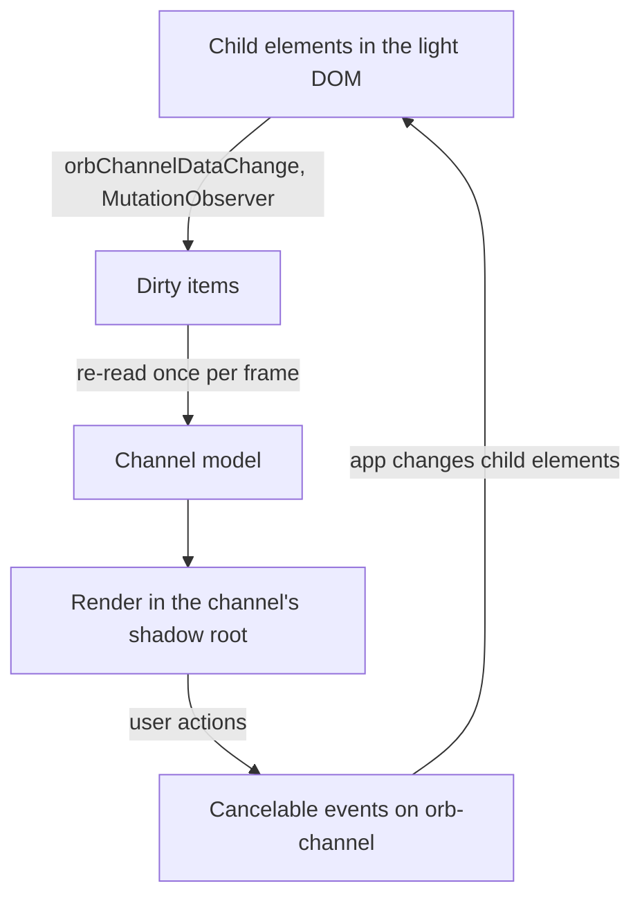

# `orb-channel` implementation plan

The phased plan for building `orb-channel`, a custom element for chat interfaces: direct chats, group chats, and open channels with threads. It starts from the API sketch in `channel-brainstorming.md`, and changes it where the rendering model requires it: styling, slots, and event names.

## Decisions

| Decision | Choice |
|---|---|
| Rendering | The channel renders everything in its own shadow root. Child elements only carry data and settings, and never render anything themselves. |
| Slots | Only for customizing the header (`header-start`, `header-title`, `header-end`) and for custom icons (`slot="icon"`). Everything else comes from a child element or an attribute. |
| Header | Built in and shown by default, from `label`, `description` and the participants. Slots customize it. |
| Icons | Actions, commands and suggestions take a custom icon from a child with `slot="icon"`, and show a basic default icon without one. |
| `/` in rich-text | Reworked to offer only the commands the app provides, in `orb-rich-text` everywhere, not just in the channel. Block formatting stays on the toolbar, the shortcuts and the Markdown typing rules. |
| Composer toolbar | `toolbar="always | toggle | none"` on `orb-channel-composer`, `toggle` by default. Only the rich editor has one. |
| Local echo | Opt-in, with `echo` on the channel. Without it, the app adds sent messages. It uses the same `client-id` matching as optimistic sends (6.2). |
| Moderation | All of it in v1 (2.9): reporting, approval, hiding and removing, muting, slow mode and moderator actions. The channel shows and asks; the server enforces. |
| Kinds and presets | `kind` (`direct`, `group`, `open`) is who's in the conversation. `preset` (`assistant`, `workspace`, `comments`, `live`) is a familiar format, and sets the attributes people would otherwise have to remember, including `kind`. Every setting is its own attribute. An attribute wins over the preset, and the preset over the built-in default. No `broadcast` preset, and no custom presets until someone asks. |
| Branching | The app stores the tree of edited and regenerated versions. The DOM holds only the path on screen, and `<orb-channel-variants>` shows the switcher (3.8). The channel's model stays a list. |
| Child-to-parent updates | Child elements emit one generic bubbling event, `orbChannelDataChange`, when their props change. A `MutationObserver` on the channel covers what events can't: removed elements and text changes. No registry. |
| Inert content | Rich message content goes in `<script>` tags: `text/markdown`, `text/html`, and `application/json` for tool data. Plain text children are read as text. |
| Sanitizing | HTML from `text/html` scripts and from the rich composer is sanitized before it's rendered, with a chat allowlist that's stricter than rich-text's paste cleanup. |
| Typography | The channel has its own lightweight content styles, tuned for chat. It doesn't copy `native.scss`. Design tokens (`--orb-*`) still apply, since custom properties inherit into shadow roots. |
| Composer | `editor="plain"` renders `orb-textbox` with a `textarea`. `editor="rich"` renders `orb-rich-text`. Rich-text is changed to fit chat directly (Phase 0), with no wrapper component. |
| Threads | No thread element. A reply has `thread="id"`, pointing at the message it replies to. Messages are never nested in the DOM, since data arrives flat and nesting it is extra work for apps. The channel shows threads in a panel or inline. |
| Message order | DOM order. `ts` is only displayed. |
| Transport | None until Phase 6. Until then the channel is local, fed by DOM changes. |
| AI protocols | None built in. The core has a protocol-neutral message writer (3.9), and `channel.md` has a short recipe per SDK (6.6). No adapters for now. |

## Conventions

- **Same as `rich-text-phases.md`:** Stencil and shadow DOM, `orb-` tags, JSDoc on every prop, event, method and part, cancelable events for interception, arrays and objects set as JS properties, custom states through `ElementInternals` and `toggleState`, Playwright specs using `mount()` from `tests/utils.ts` in Chromium, Firefox and WebKit.
- **Events are camelCase**, like the rest of the codebase (`orbValueChange`, `orbEditorChange`). The brainstorm's `orb-channel-send` becomes `orbSend` on `orb-channel`.
- **User-facing events fire from `orb-channel`**, since that's where the UI is. Their `detail` includes the child element involved (`message`, `toolCall`, `composer`), so an app can answer by changing that element.
- **Each child element is its own component folder**, like `menu-item` and `wizard-item`: `src/components/channel-message/`, `src/components/channel-participant/`, and so on.
- **Build the UI from existing Orb components** inside the shadow root: `orb-textbox`, `orb-rich-text`, `orb-button`, `orb-menu`, `orb-popover`, `orb-tooltip`, `orb-details`, `orb-pill`, `orb-relative-time`, `orb-copy-button`, `orb-loading`.

## Phases at a glance

| Phase | Contents | Estimate (1 developer) |
|---|---|---|
| 0. Rich-text changes | Enter to send, `/` reworked for app commands, bottom toolbar, utility slots, compact variant | 2–3w |
| 1. Foundation | Child elements and the change event, the model, text messages, participants, grouping, filling in settings from `kind` and `preset`, header, styles, plain composer, local echo | 3.5–4.5w |
| 2. Content | Markdown and HTML messages, sanitizing, rich composer, mentions, commands, reactions, attachments, dividers, unread, message actions, moderation | 4.5–6w |
| 3. AI | Streaming, reasoning, tool calls and approval, stop, citations, suggestions, variants, message writer | 3–4w |
| 4. Scale | Threads, virtualization, paging, jump to latest, receipts, typing, presence | 3.5–5w |
| 5. Formats | Layouts, scrolling options, announcements, votes, sorting, action lists, coalescing, presets | 2.5–3.5w |
| 6. Transports | Transport interface, optimistic sends, declarative transports, participant sources, drafts, AI recipes | 1.5–2.5w |

**Total: about 20.5–28.5 weeks.** These are rough. Each phase ends with its tests and an update to `channel.md`.

---

## Architecture

### How data flows



### Child elements

Each child element:

- Uses `shadow: true` and renders an empty `<Host>`. A shadow root without a slot hides its light-DOM children, so nothing shows, even outside a channel.
- Declares `@Event() orbChannelDataChange: EventEmitter<void>` (bubbles, not composed), and emits it from one `changed()` method that stacks a `@Watch` for each prop, like `handleStateChange` in `orb-file-input`.
- Emits it once from `componentDidLoad`. Stencil loads components lazily, so a child may upgrade after the channel first reads it.

The channel listens for `orbChannelDataChange`, finds what changed with `event.target.closest(...)` (the message, participant, or composer), and marks it dirty.

Events can't cover everything, so the channel also observes itself with `childList`, `characterData` and `subtree`:

- A removed element is already detached, so its event can't reach the channel.
- Streamed text, into a text node or a `<script>`, changes text, not props.

Attributes don't need observing. Every documented attribute is a prop, so a change runs its `@Watch`, which emits the event.

Dirty items are re-read once per animation frame, so a burst of streamed tokens is one render.

The channel writes to its children in only a few places: the composer's form value (1.5), echoed messages (1.5) and optimistic messages (6.2). It ignores the change events its own writes cause.

### Slots

The channel's shadow root has named slots only, and no default slot, so child elements that aren't slotted are never shown.

- **Header slots** take direct children of `orb-channel`, like any slot. Their content is the app's, so page styles apply to it.
- **Icon slots** are on child elements that are deeper down, such as an action inside the composer. A slot can only take the host's direct children, so the channel copies the icon into its shadow root instead. Page styles don't reach the copy, so icons should use `currentColor`. To change an icon, replace the element: the observer sees added and removed children, but not attribute changes inside an SVG.

### The model

```ts
interface ChannelModel {
  participants: Map<string, Participant>;
  /** Messages without `thread`, in DOM order */
  messages: MessageModel[];
  /** Replies, by the id in their `thread`, in DOM order */
  replies: Map<string, MessageModel[]>;
}

interface MessageModel {
  el: HTMLElement;
  id: string;
  from: string;
  ts?: string;
  status?: MessageStatus;
  /** The id of the message this replies to */
  thread?: string;
  /** In DOM order */
  parts: Part[];
  reactions: Reaction[];
  version: number;
}

type Part =
  | { type: "text"; text: string }
  | { type: "markdown"; source: string }
  | { type: "html"; fragment: DocumentFragment } // sanitized
  | { type: "reasoning"; el: HTMLElement; state: string; text: string }
  | { type: "tool-call"; el: HTMLElement; name: string; status: string; args?: unknown; result?: unknown }
  | { type: "attachment"; el: HTMLElement }
  | { type: "citation"; el: HTMLElement };
```

Models are cached in a `WeakMap<Element, MessageModel>`. Only dirty ones are read again.

A message's parts come from its `childNodes`, in order. Text runs become text parts, `<script>` tags become markdown or HTML parts, and child elements become their own typed part. Reactions aren't positional, so they're collected separately. An `orb-channel-message` inside another message is ignored, with a console warning, since replies use `thread`.

### Rendering

Stencil JSX in `channel.tsx`, with rows and parts as functional components in `render/`. If profiling shows long lists re-rendering too much, rows can become an internal `shadow: false` component. That still renders into the channel's shadow tree, so styles and parts keep working.

There are no nested shadow roots, so one stylesheet styles everything and `::part()` reaches every element.

### Module layout

```
src/components/channel/
  channel.tsx            root: props, events, methods, listeners, render
  channel.css            chrome; CSS custom properties documented at the top
  channel.md
  model/
    types.ts
    parse.ts             child elements to model
    content.ts           text, markdown and HTML parts; streaming markdown
    sanitize.ts          chat allowlist, on top of rich-text's sanitize()
  writer.ts              createMessageWriter (3.9), exported from src/index.ts
  render/
    header.tsx  message.tsx  parts.tsx  composer.tsx  thread.tsx  divider.tsx
src/components/channel-participant/  channel-message/  channel-divider/  ...
src/styles/
  _chat-content.scss     chat content styles, shared with orb-rich-text's compact variant
src/utils/
  markdown.ts            the markdown-it loader, moved out of orb-markdown
```

### Styling

Parts live in the channel's shadow root, so they're styled from `orb-channel`, not from the child elements. State goes into part names, and `::part()` with several names matches only elements that have all of them:

```css
orb-channel::part(bubble) { border-radius: 1rem; }
orb-channel::part(message self) { … }
orb-channel::part(bubble streaming) { … }
orb-channel::part(message ai first-in-group) { … }
```

- **Parts:** `header`, `header-title`, `header-description`, `header-avatars`, `list`, `message`, `bubble`, `avatar`, `name`, `badge`, `time`, `status`, `reactions`, `thread-badge`, `reasoning`, `tool-call`, `variants`, `divider`, `composer`, `toolbar-toggle`, `jump-pill`, `thread-panel`.
- **State names on `message` and `bubble`:** `self`, `ai`, `streaming`, `failed`, `unread`, `first-in-group`, `last-in-group`, `pinned`, `deleted`, `pending`, `hidden`, `removed`.
- **Channel custom states:** `:state(streaming)`, `:state(thread-open)`, `:state(offline)`.
- **Participant colors:** an `accent` attribute on `orb-channel-participant`, copied into `--accent` on that participant's messages. CSS variables set on a child element don't reach the messages rendered in the shadow root.
- **Custom properties** on `orb-channel`, such as `--orb-channel-gap`, `--orb-channel-max-width`, `--orb-channel-bubble-background` and `--orb-channel-self-background`.

### Content styles

`src/styles/_chat-content.scss` holds a small set of styles for paragraphs, lists, links, inline code, code blocks, blockquotes, mentions (`[data-mention]` chips), commands (`[data-command]` chips) and images. Line height and spacing are tighter than in `native.scss`, and everything is built from tokens.

`channel.css` uses it, and so does `orb-rich-text`'s compact variant (0.5), so a message looks the same in the composer and once it's sent.

### Kinds and presets

`kind` is who's in the conversation. `preset` is a familiar format: it sets the attributes people would otherwise have to remember to set for it. Every setting is an attribute of its own, and the first of these that has a value wins:

1. The attribute on the element.
2. The preset. It also sets `kind`, when `kind` isn't set.
3. The built-in default, which can depend on `kind`.

#### Filling in the settings

Props that a preset or `kind` can set have no default in their declaration, so a prop the app hasn't set is `undefined`:

```ts
/** How messages are laid out. The default depends on `preset` and `kind`. */
@Prop({ mutable: true }) layout?: Layout;
```

Their JSDoc points to the tables below, so the generated docs don't claim a default that a preset changes. `componentWillLoad` fills them in before the first render, like `orb-checkbox` sets `defaultChecked`:

```ts
componentWillLoad() {
  const preset = PRESETS[this.preset] ?? {};
  this.kind ??= preset.kind ?? "direct";
  const builtIn = BUILT_IN[this.kind];
  for (const key of SETTINGS) this[key] ??= preset[key] ?? builtIn[key];
}
```

- **Changing `preset` or `kind` later:** the channel remembers which props it filled in, and fills those in again. A prop the app sets is forgotten, so it's never overwritten. The channel ignores the `@Watch` calls caused by its own writes.
- **Props, not attributes:** filled-in values aren't reflected. An htmx or Turbo morph would remove attributes that aren't in the server's HTML, and the channel would take that as the app clearing them.
- **Composer settings** (`editor`, `send-on`, `toolbar`) are on `orb-channel-composer`, which the channel doesn't write to. The channel follows the same order for them when it renders.
- **Custom presets** (`registerChannelPreset`, like `registerPipe`) wait until someone asks for them.

#### Built-in defaults

By `kind`:

| Setting | `direct` | `group` | `open` |
|---|---|---|---|
| `show-names` | off | on | on |
| `avatars` | off | on | on |
| `receipts` | `read` | `delivered` | `none` |
| `typing` | on | on | off |
| `presence` | `full` | `full` | `sampled` |
| `threads` | `none` | `none` | `panel` |

The same for every kind: `layout="bubbles"`, `anchor="bottom"`, `follow="bottom"`, `group-within="5m"`, `date-dividers` on, `announce` on, `jump-to-latest` on, `max-depth="1"`, `votes="none"`, no `sorts`, `actions="react reply copy edit delete"`, no `window`, updates once per frame, `reasoning="collapsed"`, and on the composer, `editor="plain"`, `send-on="enter"` and `toolbar="toggle"`.

Without a preset, a channel is a messaging app with bubbles, like WhatsApp or iMessage.

#### Presets

A blank cell leaves the setting to the built-in default.

| Setting | `assistant` | `workspace` | `comments` | `live` |
|---|---|---|---|---|
| Like | ChatGPT, Claude | Slack, Discord | Article comments, YouTube | Twitch, webinars |
| `kind` | `direct` | `open` | `open` | `open` |
| `layout` | `assistant` | `flat` | `flat` | `compact` |
| `show-names`, `avatars` | off, off | | | on, off |
| `receipts`, `typing`, `presence` | `none`, off, `none` | `none` | `none`, off | `none` |
| `threads` | `none` | `panel` | `inline` | `none` |
| `max-depth` | | | 4 | |
| `anchor` | | | `top` | |
| `follow` | `question` | | | |
| `pause-on-scroll` | | | | on |
| `jump-to-latest` | | | off | off |
| `group-within` | | | 0 | 0 |
| `date-dividers` | off | | off | off |
| `announce` | | | off | off |
| `votes`, `sorts` | | | `up-down`, `top new old` | |
| `actions` | `copy regenerate edit` | `react reply copy edit delete pin` | `reply copy-link edit delete report` | `report` |
| `window`, `coalesce` | | | | 200, 250ms |
| Composer `editor` | | `rich` | `rich` | |
| Composer `send-on` | | | `mod-enter` | |

These defaults are a starting point, to be tuned once the channel is in use.

---

## Phase 0: Rich-text changes

These are made in `orb-rich-text` itself, behind props, so document editing doesn't change.

### 0.1 Enter to send

Today `handleKeyDown` always prevents Enter and inserts a paragraph, and whether the trigger menu is open is private. So the channel can't safely take Enter from outside.

- New prop `enterAction: "paragraph" | "submit"`, `paragraph` by default.
- With `submit`, Enter emits a cancelable `orbSubmit` with the same detail as `orbEditorChange` (`html`, `text`, `isEmpty`). It runs after the existing checks: not while an input method is composing, and not while the trigger menu is open, where Enter still picks the item.
- Shift+Enter inserts a line break. Inside a code block, Enter inserts a new line, and Mod+Enter submits.
- Empty content doesn't submit.

### 0.2 `/` for app commands

Today `slashTrigger` offers the editor's own block formatting. That's a mistake: `/` should be for commands the app provides. This changes `orb-rich-text` everywhere, not only in the channel.

- New prop `commands?: (query: string) => TriggerItem[] | Promise<TriggerItem[]>`. `/` at the start of a block offers its items. Without it, `/` is just a character.
- Choosing one inserts a non-editable chip, `<span data-command="id">/name</span>`, then a space, so arguments can be typed after it. Like mentions, the chip is part of the HTML output.
- It emits `orbCommand` with `{ id, label }`.
- It reuses the existing `Trigger` machinery: `items`, `choose`, `async`, `blockStart`.
- Removed: the `SLASH` keyword map in `editing/triggers.ts` and the `slash` field on commands. Block formatting stays on the toolbar, the menubar, the shortcuts and the Markdown typing rules.
- Also changes: the "Menus while typing" section of `rich-text.md` (including the table-cell note), section 4.1 of `rich-text-phases.md`, and the tests that open `/` for block commands in `rich-text-inline.spec.ts` and `rich-text-chrome.spec.ts`. They move to a `commands` lookup.

### 0.3 Toolbar at the bottom

`toolbarPlacement` gets `bottom`. The toggle (2.2) switches between `bottom` and `none`, so rich-text needs nothing more for it. Check that switching keeps focus and the selection in the content, and that the toolbar's overflow is measured again when it reappears.

### 0.4 Utility slots

The same names and behavior as `orb-textbox`: `top-start`, `top-end`, `bottom-start`, `bottom-end`, inside the editor's border. The channel puts attachments in `top-start`, actions in `bottom-start`, and send or stop in `bottom-end`, in the same places for both editors.

These are rich-text's slots, filled by the channel inside its own shadow root.

### 0.5 Compact variant

New prop `variant: "document" | "compact"`, `document` by default. With `compact`:

- Content uses `_chat-content.scss` instead of the document content styles.
- Less shell padding, no word count by default, a minimum height of one line, and no menubar.
- The accessible name can come from `aria-label` without a visible label. Check whether `syncAttributes` already covers this.

### 0.6 Tests

Enter submits and `clear()` empties the editor. Shift+Enter, Enter while composing, Enter with the mention menu open, Enter and Mod+Enter in a code block. `/` with async command items, the chip in the output, and `/` as a plain character without `commands`. Keyboard navigation in the bottom toolbar. Utility slots.

## Phase 1: Foundation

### 1.1 Child element scaffolding

The empty-render, `orbChannelDataChange` pattern, for `orb-channel-participant`, `orb-channel-message`, `orb-channel-divider`, `orb-channel-composer` and `orb-channel-action`.

### 1.2 Model and updates

`parse.ts`, dirty tracking, the once-per-frame flush, and the observer. When two messages have the same id, the later element wins, with a console warning.

### 1.3 Channel attributes

- `kind`: `direct`, `group` or `open`.
- `preset`: `assistant`, `workspace`, `comments` or `live`. Filling in settings from `kind` and `preset` (see Kinds and presets) is built here, with the built-in defaults. The presets themselves come in 5.8.
- `pov`: the id of the participant whose point of view the channel shows. Their messages get the `self` state.
- `readonly`, `disabled`.
- `label`: the header's title, and the accessible name of the message log.
- `description`: the header's second line.
- `show-header`: `true` by default.
- `empty`: text shown when there are no messages.
- `echo`: the channel adds sent messages itself (1.5).

### 1.4 Text messages

- Attributes: `id`, `from`, `ts`, `status`, `edited`.
- Plain text keeps its line breaks, and URLs become links.
- Consecutive messages from one sender are grouped, within `group-within` (5 minutes by default).
- `show-names` and `avatars`, with defaults from `kind`. Times use `orb-relative-time`.
- A `from` with no matching participant shows the id and a generic avatar.

### 1.5 Plain composer

`<orb-channel-composer editor="plain" placeholder="…" max-length="4000" send-on="enter | mod-enter" name="body">`

- Renders `orb-textbox` with a `textarea`, and a send button in `bottom-end`. The channel's styles cap the textarea's height.
- Enter sends, unless an input method is composing.
- Emits a cancelable `orbSend` with `{ text, format, to, composer, message }`. If it isn't canceled, the composer is cleared.
- Without `echo`, the app adds the message, and `message` is `null`.
- With `echo`, the channel appends `<orb-channel-message from="{pov}" client-id="…" status="sent">` after the event, and `message` is that element. A message the app adds later with the same `client-id` replaces it. Optimistic sends (6.2) reuse this code, with `status="sending"`.
- `orb-channel-composer` is form-associated. The channel writes its `value`, and the composer calls `setFormValue` under its `name`. A form reset changes the composer's `value`, which emits the change event, and the channel clears the editor.
- `<orb-channel-action name="attach" label="Attach file">` inside the composer becomes a button in `bottom-start`. Clicking it emits `orbAction` with `{ name, composer }`.
- An action's icon comes from a child with `slot="icon"`, which the channel copies (see Slots). Without one, it shows a basic default icon. The `label` is the button's accessible name and tooltip.

```html
<orb-channel-action name="attach" label="Attach file">
  <svg slot="icon" viewBox="0 0 24 24" fill="none" stroke="currentColor">…</svg>
</orb-channel-action>
```

### 1.6 Header

Shown unless `show-header="false"`. Its default content follows `kind`:

| `kind` | Title | Second line | Avatars |
|---|---|---|---|
| `direct` | `label`, or the other participant's name | `description`, or their presence | The other participant |
| `group` | `label`, or the participants' names | `description`, or the member count | A few, stacked |
| `open` | `label` | `description`, or the member and online counts | None |

Slots, all direct children of `orb-channel`:

- `header-start`: before the title, such as a back button.
- `header-title`: replaces the default title, second line and avatars.
- `header-end`: after the title, such as call, search or settings buttons.

```html
<orb-channel kind="group" pov="ada" label="Design team">
  <orb-button slot="header-start" fill="clear" aria-label="Back">…</orb-button>
  <orb-button slot="header-end" fill="clear" aria-label="Search">…</orb-button>
  …
</orb-channel>
```

The thread panel (4.1) has its own built-in header, without slots.

### 1.7 Scrolling

The list stays at the bottom while the user is there, and stays put once they've scrolled up, including while content grows. `prefers-reduced-motion` turns off smooth scrolling.

### 1.8 Accessibility baseline

- The list has `role="log"` and `aria-live="polite"`, named by `label`.
- Arrow keys move between messages with a roving tabindex, and Home and End go to the first and last.
- The composer is named from its `placeholder` or `label`.

### 1.9 Styles

The chrome, the first version of `_chat-content.scss`, parts and their state names, custom properties, `light-dark()` for both color schemes, and forced colors.

### 1.10 Methods

`scrollToMessage(id, { behavior })`, `focusComposer()`, and `send(text)`, which goes through the same path as the composer. Apps add, change and remove messages with DOM APIs. Helpers like `append()` are only added if that proves awkward.

### 1.11 Tests

Rendering from markup, updates from prop changes, text changes and removals, grouping, settings filled in from `kind`, attributes overriding them, changing `kind` after loading, the header and its slots, slotted and default icons, sending from the keyboard and the button, `echo` and `client-id` replacement, form association and reset, scroll anchoring, keyboard navigation.

## Phase 2: Content

### 2.1 Markdown and HTML messages

- `<script type="text/markdown">` and `<script type="text/html">` inside a message.
- The markdown-it loader moves to `src/utils/markdown.ts`, and `orb-markdown` uses it from there. Markdown is rendered with `html: false`.
- HTML goes through `model/sanitize.ts`. One decision for this step: whether inline styles from the rich composer, such as colors, are kept.
- Code blocks get an `orb-copy-button`. Syntax coloring can reuse `highlightCode` from rich-text, loaded on first use.

### 2.2 Rich composer

`editor="rich"` renders `orb-rich-text` with `variant="compact"` and `enter-action="submit"`. Its `mentions` come from the participants, and its `commands` from `orb-channel-command` elements. It sends HTML (`format: "html"`).

The composer's `toolbar` attribute sets the formatting toolbar:

- `always`: `toolbar-placement="bottom"`.
- `toggle` (default): a formatting button (part `toolbar-toggle`, `aria-pressed`) in `bottom-start` switches `toolbar-placement` between `bottom` and `none`. The choice is kept while the composer exists, and with `drafts="persist"` (6.5) it's stored with the draft.
- `none`: `toolbar-placement="none"`. Formatting still works from the shortcuts and the Markdown typing rules.

The plain editor has no toolbar, so it ignores `toolbar`.

### 2.3 Mentions

- In rich mode, rich-text's `@` menu, as set up in 2.2.
- In plain mode, an `orb-menu` at the caret. Finding the caret's position in a `textarea` needs a mirror element.
- `orbSend`'s detail gets `mentions: string[]`.
- Mentions show as chips, and a mention of the `pov` participant gets the `mention-self` part.

### 2.4 Commands

`<orb-channel-command name="summarize" description="…" args="prompt">` inside the composer. `/` at the start opens the command menu in both modes. A command's icon comes from a `slot="icon"` child, like actions, with a default icon without one. `orbSend`'s detail gets `command: { name, args }`.

### 2.5 Reactions

`<orb-channel-reaction emoji="🎉" by="grace">` elements are combined into pills with counts. Clicking one emits a cancelable `orbReact` with `{ message, emoji, on }`. The emoji picker reuses rich-text's emoji data loader.

### 2.6 Attachments

- `attachments="image/*,.pdf"` on the composer. Files can be picked, dropped or pasted, and are previewed like in `orb-file-input`.
- `isAccepted` moves to `src/utils/files.ts`, as the rich-text plan already proposes.
- `orbSend`'s detail gets `files: File[]`. Uploading is the app's job.
- `<orb-channel-attachment href name type size>` in a message shows images inline and other files as cards.

### 2.7 Dividers and unread

- `<orb-channel-divider type="date | unread | custom">`. With `date-dividers`, the channel adds date dividers itself.
- `unread` is reflected on the channel as a count.
- `orbRead` is emitted as messages are seen, using an `IntersectionObserver`.

### 2.8 Message actions

- An actions menu opens from a right click, a long press on touch, or the Menu key. It starts with a row of reactions, then reply, copy, and edit and delete for the user's own messages. The `actions` attribute (5.6) makes the list configurable.
- `orbEdit` and `orbDelete` are cancelable. Editing happens in place, with the same editor type as the composer.
- `reply-to` shows a quote of the message it answers.

### 2.9 Moderation

The channel shows moderation states and asks for actions through events. The server enforces everything.

- **Reporting:** a "Report" message action on other people's messages emits `orbReport` with `{ message }`. The app shows its own form or calls its API.
- **Moderation states:** `moderation="pending | hidden | removed"` on a message, with an optional `moderation-reason`. It isn't named `hidden`, which is a global HTML attribute.
  - `pending`: faded, with "Awaiting approval". The app sends these only to the author and moderators.
  - `hidden`: collapsed to a line with the reason, such as "Hidden for low score", and a "Show anyway" button.
  - `removed`: "Removed by a moderator", with no content. Its replies stay.
- **Moderators:** `moderator` on a participant shows a badge (part `badge`). When the `pov` participant is a moderator, the message actions add hide, remove, pin and mute, on anyone's messages. They emit a cancelable `orbModerate` with `{ action, message, participant }`.
- **Muting:** `muted` on a participant, with an optional `muted-until`. When it's the `pov` participant, the composer is disabled and says why, with a countdown when `muted-until` is set.
- **Ignoring:** `ignored` on a participant collapses their messages for this viewer only, with "Show anyway".
- **Slow mode:** `slow-mode="30s"` on the channel. After sending, the composer shows a countdown and stays disabled until it ends. Moderators aren't affected.
- **Accessibility:** collapsed and removed messages stay in the arrow-key order, and say why they're collapsed. The countdowns are announced when they start and end, not every second.

## Phase 3: AI

### 3.1 AI participants

- `role="human | ai | bot | system"`. Messages from `ai` participants get a badge, worded by `ai-label`.
- `respond-to`, `context` and `reply-in` are only data. The channel doesn't call models.
- From them and the mentions, the channel works out which AI participants should answer, and adds `respondents: string[]` to `orbSend`'s detail, so the app knows whom to call.

### 3.2 Streaming

- A message with `streaming` shows a cursor.
- Markdown is re-rendered at most once per frame, from the last complete block on. Unclosed code fences show as open code blocks.
- Screen readers hear streamed text at sentence boundaries, and the full text when it's done.
- `prefers-reduced-motion` hides the cursor.

### 3.3 Reasoning

`<orb-channel-reasoning state="thinking | done" label duration>` is shown with `orb-details`. The channel's `reasoning` attribute is `show`, `collapsed` (default) or `hidden`.

### 3.4 Tool calls

- `<orb-channel-tool-call name call-id status requires-approval>`, with `<script type="application/json" data-part="args">` and `data-part="result"`.
- With `status="awaiting-approval"`, approve and deny buttons emit a cancelable `orbToolDecision` with `{ toolCall, callId, approved }`.

### 3.5 Stop and sending while streaming

- While any AI message is streaming, the stop button takes the send button's place, and emits `orbStop`.
- `while-streaming="queue | block | interrupt"` on the composer controls what sending does meanwhile.

### 3.6 Citations

`<orb-channel-citation href index title>` shows as a numbered link with a popover.

### 3.7 Suggestions

`<orb-channel-suggestions>` with `<orb-channel-suggestion>` children shows chips. Clicking one fills the composer, or sends it right away with `send`. A suggestion can have a `slot="icon"` child. Without one it shows no icon, since text chips don't need one.

### 3.8 Variants

Branching, such as editing an earlier message or regenerating an answer, is a tree, and the app stores it. The DOM only holds the path that's on screen, like everything else in the channel. The channel shows a version switcher and asks the app for changes, and the app swaps the path.

```html
<orb-channel-message id="u1b" from="ada">
  Plan a weekend in Porto
  <orb-channel-variants current="2" count="2"></orb-channel-variants>
</orb-channel-message>
<orb-channel-message id="a4" from="claude">
  <script type="text/markdown">Ribeira…</script>
</orb-channel-message>
```

- **The switcher:** `<orb-channel-variants current count>` in a message shows "‹ 2 / 2 ›" (part `variants`). Like reactions, it isn't positional. The buttons are named "Previous version" and "Next version", and the switcher reads as "Version 2 of 2".
- **Switching:** a button emits `orbVariantChange` with `{ message, current }`, where `current` is the version asked for, counting from 1. The channel changes nothing itself. The app fetches that path and replaces the messages from this one on. While it does, it can set `busy` on the switcher, which disables the buttons and shows `orb-loading`.
- **Regenerating:** the `regenerate` action (5.6) emits a cancelable `orbRegenerate` with `{ message }`. The app replaces the message and writes the new version with the message writer (3.9), which takes `variants: { current, count }`.
- **Editing:** the app decides in its `orbEdit` handler (2.8). It can change the message in place, or fork: store the new version and replace the path from that message on. The `assistant` preset's docs show forking.
- **`replaceFrom(message, content)`:** a method that removes the message and every top-level message after it, with their replies, and then adds `content`. That can be an HTML string, an element or a fragment. HTML is parsed in a `<template>`, as in 6.3. Every app using branching needs this, and it's easy to get wrong with replies and dividers.
- **Keeping the place:** after a switch, the first new message takes the old one's place on screen, rather than the list jumping to the bottom. Focus moves to its switcher, and the new version is announced.

```js
channel.addEventListener("orbVariantChange", async (e) => {
  const { message, current } = e.detail;
  channel.replaceFrom(message, await api.path(chatId, message.id, current));
});

channel.addEventListener("orbEdit", async (e) => {
  e.preventDefault(); // fork instead of changing the message
  const { message, html } = e.detail;
  channel.replaceFrom(message, await api.fork(chatId, message.id, html));
  streamAnswer(createMessageWriter(channel, { from: "claude" }));
});

channel.addEventListener("orbRegenerate", async (e) => {
  const { message } = e.detail;
  const { current, count } = await api.newVersion(chatId, message.id);
  channel.replaceFrom(message, "");
  streamAnswer(createMessageWriter(channel, { from: "claude", variants: { current, count } }));
});
```

### 3.9 Message writer

`createMessageWriter`, exported from `src/index.ts`, writes a streaming message into the DOM without knowing any SDK. It only changes elements, so everything it does could be written by hand, and the channel batches its changes like any other.

```ts
const writer = createMessageWriter(channel, { from: "claude" }); // appends <orb-channel-message streaming>
writer.reasoning("The user wants…");  // starts or continues the reasoning block
writer.toolCall({ callId: "t1", name: "fetch_schema", args: { id: "v2" }, status: "running" });
writer.toolResult("t1", { fields: 12 });
writer.text("Here's what changed");  // appends to the message's markdown script
writer.finish();                       // removes streaming, and marks reasoning done with its duration
writer.fail("Connection lost");        // status="failed"
```

`writer.message` is the element, so apps can add anything the writer doesn't cover.

## Phase 4: Scale

### 4.1 Threads

There's no thread element. A reply points at the message it replies to with `thread`, and all messages are siblings in the DOM:

```html
<orb-channel kind="open" pov="u_42" open-thread="m100">
  <orb-channel-message id="m100" from="u_7">Release 2.0 is out!</orb-channel-message>
  <orb-channel-message id="m101" from="u_9" thread="m100">Congrats!</orb-channel-message>
  <orb-channel-message id="m102" from="u_3">Anyone going to the meetup?</orb-channel-message>
  <orb-channel-message id="m103" from="relbot" thread="m100">Changelog: …</orb-channel-message>
</orb-channel>
```

- **Order:** replies can be anywhere among the other messages. Within a thread, DOM order is the order.
- **Missing parents:** a reply whose parent isn't in the DOM is kept but not shown, until the parent arrives.
- **Depth:** a reply can point at another reply. `max-depth` (1 by default) sets how many levels are indented. Replies past it show at the deepest level, in DOM order. So with the default, a reply to a reply shows in the same thread, like Slack.
- **Counts:** the parent shows how many replies it has and when the last one came, from the replies in the DOM. `thread-count` and `thread-last` on the parent override them, for when not every reply is loaded. If replies are missing, "View 14 replies" emits `orbLoadMore` with `{ parent }`.
- **State:** `thread-state="collapsed | resolved"` on the parent.
- **Showing:** `threads="none | inline | panel"`.
  - The panel is beside the list when there's room, and over it when there isn't, using a container query.
  - Inline threads show under their parent. They're expanded unless `thread-state="collapsed"`, and the user can collapse and expand them. The channel keeps that itself, without changing the attribute.
- **The open thread:** `open-thread="m100"` on the channel is the thread in the panel. It's reflected, so the channel changes its own attribute, not a child's. Opening and closing emit cancelable `orbThreadOpen` and `orbThreadClose`, with `{ parent }`. Opening moves focus into the panel, and closing returns it.
- **Replying:** the panel, and each inline thread, has a reply composer with the main composer's settings. A second `<orb-channel-composer scope="replies">` overrides them, such as its `placeholder`. Sending emits `orbSend` with `to` set to the parent message, and with `echo`, the echoed message gets `thread`.
- **The reply action (2.8):** opens the thread when `threads` isn't `none`, and quotes the message with `reply-to` when it is.
- **Removed parents:** a parent with `moderation="removed"` (2.9) keeps its replies.

### 4.2 Virtualization

- The channel renders only the rows near the viewport, from the model. The app's light DOM is left alone.
- `content-visibility: auto` first, and full windowing when it's needed.
- Spacers use measured row heights (`ResizeObserver`), and estimates for rows not yet seen.
- The scroll position holds when rows above change height.

### 4.3 Paging

Near the top, the channel emits `orbLoadMore` with `{ direction, cursor }` and shows a loading row while `loading-more` is set. The app adds older messages, and the scroll position holds. In a thread, the event also has `parent`.

### 4.4 Jumping

`scrollToMessage`, a URL hash such as `#m100`, and a jump-to-latest pill that counts new messages.

### 4.5 Receipts, typing and presence

- `receipts="none | delivered | read"`.
- `typing`: a `typing` attribute on a participant shows the indicator, and the local user's typing emits `orbTyping`.
- `presence="none | sampled | full"`. `sampled` shows a count and a few avatars.

## Phase 5: Formats

The attributes the presets set, and the presets themselves. Every attribute works on its own, with or without a preset.

### 5.1 Layouts

`layout="bubbles | flat | assistant | compact"`:

- `bubbles`: messaging apps. The `pov` participant's messages are on the end side.
- `flat`: Slack, Discord and comment sections. Every message is on the start side, with its avatar and name, and no bubble.
- `assistant`: the `pov` participant's messages are bubbles on the end side. Everyone else's are full width, without a bubble, so code blocks and tables have room.
- `compact`: one line per message, `name: text`, for fast feeds.

The message content keeps the `bubble` part in every layout, so styles aimed at it still apply.

### 5.2 Scrolling

- `anchor="bottom | top"`. With `top`, the list starts at the top, the composer is above it, and `orbLoadMore` fires near the bottom, with `direction: "after"`. New messages don't move the scroll position.
- `follow="bottom | question"`. With `question`, sending scrolls the user's message to the top of the list, and the answer grows below it without the list following it.
- `pause-on-scroll`: following stops while the pointer is over the list or the user has scrolled up. A "Chat paused, 12 new" button resumes it.
- `jump-to-latest`: shows the pill from 4.4.

### 5.3 Announcements

- `announce` (on by default): the list is a `role="log"` with `aria-live="polite"`, as in 1.8.
- Off: the list is a `role="feed"` of articles, and new messages aren't announced. Comment sections and fast feeds use this.
- With `max-depth` above 1, replies are rendered as a list inside their parent's article, so screen readers announce the nesting level and the number of replies. ARIA 1.3's `comment` role would fit, but 1.3 is still a draft, so it isn't used.
- Virtualization (4.2) has to keep that nesting, so with nested replies it windows top-level messages, each with its replies.
- Left and Right collapse, expand, and move to the parent.

### 5.4 Votes

- `votes="none | up | up-down"` on the channel.
- `score` on a message, and `vote="up | down"` for the `pov` participant's own vote.
- The buttons emit a cancelable `orbVote` with `{ message, value }`, where `value` is `up`, `down` or `none`. The app updates `score` and `vote`.

### 5.5 Sorting

- `sorts="top new old"`: the options in a sort menu above the list. Without it, there's no menu.
- `sort` on the channel is the current option, and it's reflected. Choosing one emits a cancelable `orbSortChange` with `{ sort }`, and the app reorders the messages, since DOM order is the order.

### 5.6 Message actions

`actions` lists the message actions (2.8), in order. The names are `react`, `reply`, `copy`, `copy-link`, `edit`, `delete`, `pin`, `regenerate` and `report`.

- `edit` and `delete` only show on the `pov` participant's messages, `regenerate` only on AI messages, and `report` only on other people's. Moderator actions (2.9) are added for moderators.
- `copy-link` copies the page's URL with the message's `#id` (4.4). `permalink="/posts/42#{id}"` on the channel sets another URL.
- `pin` emits a cancelable `orbPin` with `{ message, pinned }`. The app sets `pinned` on the message, and pinned messages are listed in the header.

### 5.7 Coalescing

`coalesce="250ms"` batches updates over that time, instead of once per frame. Fast feeds use it.

### 5.8 Presets

`preset="assistant | workspace | comments | live"`, filled in as described in Kinds and presets. `channel.md` gets the tables from that section, and an example of each preset.

### 5.9 Tests

Each layout, `anchor="top"` with loading at the bottom, `follow="question"`, pausing and resuming, `announce` off, votes, sorting, action lists, coalescing. For presets: the settings each one fills in, an attribute overriding a preset, `preset` setting `kind`, and changing `preset` and `kind` after loading.

## Phase 6: Transports

### 6.1 Transport interface

An object set as `channel.transport`, with `send(message)`, `subscribe(handlers)` and `history(cursor)`.

### 6.2 Optimistic sending

With a transport, the channel inserts `<orb-channel-message status="sending" client-id="…">` itself, and matches the server's message to it by `client-id`. A failed send gets `status="failed"` and a retry button.

### 6.3 Declarative transports

- `<orb-channel-transport type="form | sse | websocket | poll">`.
- Servers can send HTML fragments. A message with an id that's already there replaces it.
- Fragments are parsed in a `<template>`, so they're inert until they're added, and message content still has to use `<script>` tags.

### 6.4 Participant sources

`<orb-channel-participant-source href="/users?ids={ids}">` fetches unknown participants in batches.

### 6.5 Drafts

`drafts="persist"` keeps a draft per channel and thread in `localStorage`, under the channel's `key` attribute.

### 6.6 AI recipes

A section in `channel.md` with a short recipe per SDK, such as the Vercel AI SDK, OpenAI and Anthropic, mapping its stream events onto the message writer (3.9). There are no adapter modules. If the recipes get copied a lot, adapters can come later as a separate package, so SDK changes don't need an `orb-style` release.

## Open questions

None at the moment.

## Deviations from this plan

What was built differently from the plan, or added to it, while implementing. Each one is open for review.

### Phase 0: rich-text

- **Submit clears the editor.** The plan says `orbSubmit` is cancelable but doesn't say what cancel does. Here a submit that isn't canceled clears the editor, and a canceled one keeps the content.
- **Public `submit()` method.** Not in the plan. The channel's send button needs it to trigger a submit.
- **Chat styles started in Phase 0.** The compact variant needs them, so `_chat-content.scss` is created here, not in Phase 1.9. It's compiled to `chat-content.generated.css` by `stencil.config.ts`, following the `tables.generated.css` pattern, instead of being imported as SCSS.
- **Compact defaults are resolved from `variant`.** `show-word-count` and `min-height` have no default in their declarations, and the variant supplies it. This matches the plan's behavior.
- **Accessible name from `aria-label` (0.5) isn't verified.** The plan asks to check `syncAttributes`. I didn't check it or change it.

### Phase 1: foundation

- **`kind` isn't written to the element.** It's resolved by a getter: `kind`, then the preset's kind, then `direct`. The other settings are filled in as the plan describes.
- **Presets are accepted but empty.** The mechanism is in place. The preset values come in Phase 5.
- **`date-dividers` was added as a setting** in Phase 2. It wasn't in Phase 1's settings.
- **No `editor` attribute in Phase 1.** Only the plain composer existed. `editor` was added in Phase 2.
- **Dividers are label-only in Phase 1.** Date and unread dividers came in Phase 2.
- **Receipts, typing, presence and threads aren't implemented.** They're Phase 4. The kind defaults table doesn't include them yet.
- **`to` in `orbSend` is always `null`.** Send-to and threads are Phase 4.
- **`message` in `orbSend` is set after dispatch.** With `echo`, the echoed element is added after the event, so a listener sees `message` as null during dispatch and has to read the detail later.
- **Chat styles are adopted in `componentDidLoad`,** through the shared `src/utils/chat-styles.ts`. Stencil adds the component's own styles after `componentWillLoad`, so adopting earlier lost the cascade.
- **Icons live in `channel/icons.tsx`,** not `utils/icons`. The plan's action icons needed new SVGs.
- **The first view is built in `componentWillLoad`,** so methods such as `focusComposer()` find their elements. The plan doesn't say when the first view should be built.
- **Module layout differs.** There's no `render/divider.tsx` or `render/thread.tsx`. `DividerRow` lives in `render/message.tsx`. The thread file waits for Phase 4.

### Phase 2: content

- **Reactions use six fixed emoji,** not the rich-text emoji picker.
- **Actions open from a menu, not a hover toolbar.** A right click, a 500ms press on touch (cancelled by a drag of more than 10px), or the Menu key opens it, in the style of iMessage's tapback menu. The Menu key opens it beside the message and focuses the first reaction, and Escape returns focus to the message. The change came from a request to match that interaction.
- **The plain editor's `/` and `@` menus open at the text box,** not at the caret. Caret positioning would need a mirror element.
- **Editing always uses a plain textarea,** even with the rich composer. `orbEditCommit` (cancelable) is an added event for saving. The plan listed only `orbEdit`.
- **Default actions:** React, Reply and Delete only emit their events. Copy copies the text. Edit opens the in-place editor unless `orbEdit` is canceled.
- **Mute shows when it ends** ("muted until 4:30 PM"), not a live countdown.
- **Drag-and-drop and paste of files work only in the plain composer.** The rich composer uses its attach button. Rich-text's own paste and drop of images isn't routed to attachments.
- **`mention-self` marks only plain-text mentions.** Rich-text mentions are HTML spans with `data-mention`, and they don't get the part.
- **Code blocks aren't syntax-highlighted.** The plan marked this optional.
- **`unread` is set by the channel and reflected.** The plan said read-only. It's still a reflected attribute, and the app shouldn't set it.
- **`orbRead`'s detail is `{ message }`.** The plan gave no detail.
- **`orbModerate`'s `participant` is the participant element,** not an id or a model.
- **Pin only emits `orbModerate`.** The `pinned` state changes only when the app sets it. The header doesn't list pinned messages, which is Phase 5.
- **Untested behavior.** Ignored participants, the pinned state, the toolbar toggle, drag-and-drop of files, and moderation on rich content compile and run, but no test covers them yet.

### Phase 3: AI

- **Citations are a numbered button,** not a link. The button opens a popover with the link, drawn by the channel beside the list, since a popover inside the text would break the line.
- **`title` on `orb-channel-citation` is the `citationTitle` prop.** A prop named `title` clashes with the element's own `title`, so the attribute maps to a differently named prop.
- **Screen readers hear each sentence as it finishes,** in a status region on the channel, and the rest of a message when it ends. The full text isn't read again at the end, so nothing is heard twice.
- **`replaceFrom` also removes the custom dividers after the message.** Otherwise they'd be left over from the old path.
- **`replaceFrom` keeps the place on screen only when the list isn't at the bottom.** At the bottom, the list stays there, as it does for any new message.
- **Regenerate is an item in an AI message's menu.** The `actions` attribute (5.6) isn't built, so the item is always there for AI participants. `orbRegenerate` is cancelable, but the channel has no default for it, so canceling changes nothing.
- **`orbStop` is cancelable, and the channel doesn't stop the model.** The app stops the model, and its writer finishes the message.
- **`while-streaming` queues in the box.** `queue` keeps the draft in the box and sends it, through `orbSend`, when the answer finishes. Enter again while it's queued cancels the queue. `interrupt` emits `orbStop`, then sends unless the stop is canceled.
- **`send()` while an AI message streams only sends with `interrupt`.** Otherwise it does nothing, as `block` and `queue` do for the composer.
- **Suggestions sit above the message box,** not in the list. Filling a rich editor with a suggestion uses `setContent()`.
- **Approve and deny emit `orbToolDecision`, and the channel leaves the status to the app.** Canceling the event changes nothing either.
- **`respond-to` defaults to `always` in a direct chat, and to `mention` elsewhere.** The plan doesn't give a default for groups.
- **Streamed markdown is split at blank lines outside code fences.** Finished parts are rendered once. A list with a blank line inside can show as two lists until the message ends. Markdown scripts are still dedented, so a streamed answer whose every line is indented loses that shared indentation.
- **The cursor is hidden under reduced motion,** as the plan says, rather than only stopping its blink.
- **The AI badge shows on the first message of each group,** even where names are hidden, so it's never missing.
- **Streaming messages are `aria-busy`,** so the log doesn't announce every token.
- **`orb-channel-message` has an `error` prop,** not in the plan. `writer.fail(reason)` sets it, and it's shown in place of "Not sent".
- **`createMessageWriter` takes an `id`,** not in the plan, and sets `ts` to the time it's called.
- **Not covered by tests:** a suggestion filling the rich editor, and the cursor under reduced motion.

### Phase 4: Scale

- **Reply boxes are plain textareas,** even when the main composer is rich. Attachments, commands and the toolbar don't apply to replies. Their placeholder, label, send-on and max-length come from `scope=replies`, or else the main composer.
- **Inline threads don't emit `orbThreadOpen` or `orbThreadClose`.** Those events are for the panel. Opening and closing an inline thread only changes the channel's own state.
- **Panel replies aren't in the arrow-key order.** The arrow keys move through the list, including the replies shown inline, and Escape closes the panel.
- **`orbLoadMore` only asks for older messages (`direction` is always `before`).** It's emitted when the list is scrolled within 80px of its top, and again only when the oldest message changes. `after` paging isn't built.
- **Windowing starts at 200 rows, automatically.** There's no setting for it, and `content-visibility` isn't used, since the window covers the same need. Rows that haven't been drawn are estimated at 72px until they are.
- **The list keeps the row at its top in place** when rows above it change, when older messages arrive, and when a height is measured. It doesn't use the browser's scroll anchoring alone, since that doesn't work at the top.
- **`thread-state="resolved"` starts closed, like `collapsed`.** The plan doesn't say what resolved shows; here it's labelled Resolved in the summary.
- **`threads`, `receipts` and `presence` default by kind.** Direct: none, read, none. Group: none, delivered, none. Open: panel, none, sampled. The plan doesn't give these defaults.
- **Receipts only appear under the viewer's last message.** They come from the `status` the app sets, and the channel doesn't mark messages as read.
- **Typing stops after 3 seconds without a keystroke, or when a message is sent.** Replies don't emit `orbTyping`.
- **Presence is text in the header, with avatars when `sampled`.** There are no status dots on the avatars in the list.
- **The jump pill counts the messages added since the list was left at its bottom.** It's only shown once the list is above its bottom.
- **A `#id` in the URL goes to that message, and opens its thread if it's a reply.** Only the id is read from the hash.

### Phase 5: Formats

- **The default `layout` is `bubbles` for every kind.** The plan doesn't give kind defaults for it. The presets change it, and the existing tests keep their bubbles.
- **The default `actions` include `regenerate` and `report`,** and each action is filtered by who the message is from. `edit` and `delete` are the viewer's own, `regenerate` is AI, and `report` is other people's. `report` was already in the menu before this phase.
- **`copy-link` copies the page's address with `#id`,** replacing any existing hash. `permalink` takes `{id}`.
- **`pin` emits `orbPin`.** Moderator pinning (`orbModerate`) is unchanged, and its `mod-pin` item is hidden when `pin` is in `actions`.
- **`orbVote` and `orbSortChange` have no default action,** except that `sort` is set on the channel when `orbSortChange` isn't canceled. The vote buttons don't change `score` or `vote`; the app does.
- **`votes="up"` shows only the up button.** The plan doesn't say what `up` alone shows.
- **`follow="question"` brings the viewer's new message to the top** once it's drawn. To let it reach the top, the list gets bottom padding, the room below the message. The room shrinks as the answer grows below, and it's gone once the content fills the list. Re-rendering keeps the room, but doesn't scroll again.
- **`pause-on-scroll` pauses while the pointer is over the list.** Scrolling up already stops following, so hovering is the only extra pause. The pill reads "Chat paused, N new".
- **`anchor="top"` doesn't follow new messages,** hides the jump pill, and pages `after` near the bottom. The cursor is the newest message's `id`. `orbLoadMore` gets `direction` (`before` or `after`).
- **`jump-to-latest="false"` hides the pill.**
- **`announce="false"` makes the list a `feed` without `aria-live`.** Nested replies (`max-depth` above 1, inline) sit inside their parent's article in a `list` of `listitem`s. Inline threads that aren't nested stay as sibling `.thread` blocks, as in Phase 4.
- **Left and Right are: a reply's Left goes to its parent.** On a parent, Right opens its replies, or moves to the first reply when they're open, and Left closes them. The plan only says "collapse, expand, and move to the parent".
- **`coalesce` uses `setTimeout`,** not `requestAnimationFrame`, when it's above `0`. `0` keeps the per-frame update.
- **Preset values** are in the table in `channel.md`. Each preset sets its `kind` and its settings, and the rest come from the kind's defaults. `assistant` sets `follow="question"` and `group-within="0"`, `workspace` sets flat layout with names, avatars, a thread panel, delivered receipts and sampled presence, `comments` is open, flat, top-anchored, with inline threads, depth 3, `up-down` votes and sorting, and `live` is compact, with `pause-on-scroll` and a 250ms coalesce.
- **A removed attribute counts as unset.** Removing `layout` (or any setting) makes the channel refill it from the preset, rather than keeping the `null`.
- **Docs demo ids end in `-demo`.** The headings `Reactions`, `Editing`, `Threads`, `Methods` and `Versions` get the same slug as the demos' ids, so `document.querySelector("#versions")` found the heading, and the demo did nothing. The demos are `reactions-demo`, `editing-demo`, `threads-demo`, `methods-demo` and `versions-demo`.
- **Not run:** Firefox. Tests ran on Chromium and WebKit.

### Phase 6: Transports

- **The transport interface is `MessageTransport`,** not `ChannelTransport`, since the `orb-channel-transport` element's class already takes that name in the generated types. It's exported from `orb-style` with `OutgoingMessage` and `TransportHandlers`.
- **`history` is optional.** The plan lists it with `send` and `subscribe`, but a transport that only pushes messages doesn't need it. Without it, paging emits `orbLoadMore` as before.
- **`send` resolves when the server has the message,** and the server's copy comes through `subscribe`. The channel sets `status="sent"` on resolve, and the copy replaces the sending message when its `client-id` matches. A copy that arrives before `send` resolves is handled too.
- **A rejected `send` shows its reason on the message,** as `error`, in place of "Not sent". Retry is on every failed message. `orbRetry` is cancelable: without a transport, the app resends, and with one, the channel resends unless it's canceled.
- **With a transport, `echo` isn't needed.** The message shows as sending whether or not `echo` is set. The transport takes precedence over `echo`.
- **`orbSend`'s detail has `clientId`,** the id the server's copy should carry. `orbSend` is still cancelable before the transport is called.
- **Files go in POST fields and `form`, `sse` and `poll` requests.** A websocket sends JSON without them, since files aren't JSON.
- **`orb-channel-transport` `form` shows the POST response,** when it isn't empty, as it's the server's copy. The plan doesn't say what `form` does with the response.
- **Declared transports have no `history`.** Paging with `orb-channel-transport` still emits `orbLoadMore`, for the app to load older messages.
- **A websocket reconnects two seconds after it closes.** While it's closed, sending fails with "The connection is closed". The plan doesn't mention reconnecting.
- **`poll` fetches once when it starts, then every `interval`,** and defaults to 5s. A failed poll is logged, not shown.
- **The participant source returns HTML,** like the other fragments, not JSON. Requests cover up to 50 people each. Only the `from` ids of messages and their replies are asked for, not mentions. A person is asked for once, even if the `href` changes later. A failed request is logged, and that person is asked for again on the channel's next change.
- **`key` is an attribute, but the prop is `draftKeyName`.** Stencil reserves `key` as a prop name. The attribute is still `key` in the markup and the docs.
- **A draft is restored over the composer's text.** With `drafts="persist"` and a `key`, loading the channel, or changing `key`, puts the saved draft in the composer, even when the saved draft is empty.
- **A thread's reply draft is saved under its parent message's `id`.** A reply box whose message has no `id` isn't saved.
- **The docs' AI recipes are code samples, not live demos.** They're checked against the published type definitions of `ai`, `@anthropic-ai/sdk` and `openai`, not run against a model.
- **`loadingMore` is mutable.** The channel sets it while `history` loads, as well as the app.
- **Not run:** Firefox again. Tests ran on Chromium and WebKit.
