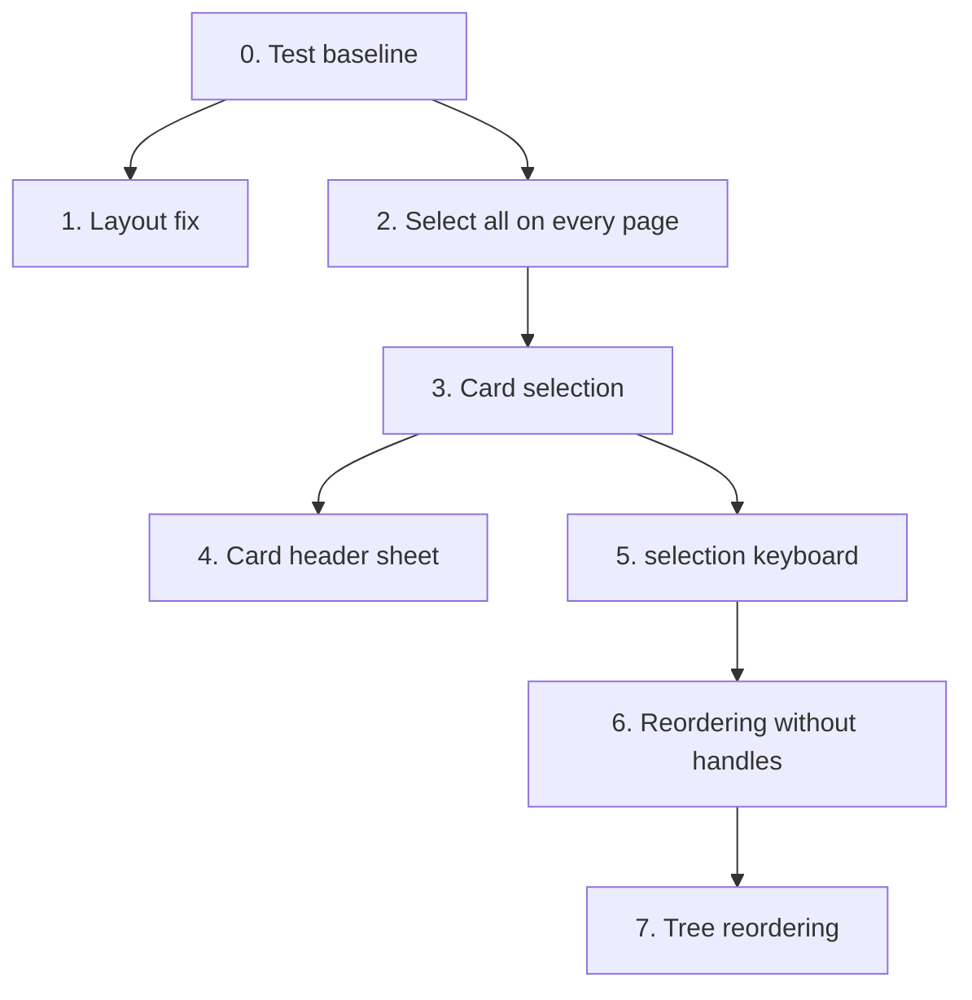

# `orb-grid` new features and fixes

## Requests

- new option for selection `selection="keyboard"` that does not show radios or checkboxes, but enables traditional table keyboard functionality you would find in an app like macos finder or windows file explorer
- reordering should not show icons and should allow user to drag by holding down anywhere on a row
- need to support reordering on tree grids
- on the products demo, layout=auto does not work, could potentially be because the grid goes off screen, which it should never be doing, it should scroll at some point
- select all on paginated client side grids should select all on every page
- on card layout, the header cells should not have sorting and filtering buttons, and on click should open a bottom sheet with a sort option and the entire filter interface
- on card layout, there should be no selection icons, and you should just be able to tap the card and it have a visual selected state

---

# Implementation plan

The files involved:

| File | What changes |
|---|---|
| `src/components/grid/grid.tsx` | Most of the work: selection modes, row presses, pointer reordering, tree moves, card mode |
| `src/components/grid/grid.css` | Containment, card selection styles, drag styles, removing handle styles |
| `src/components/grid-cell/grid-cell.tsx` / `.css` | Card header chips, the bottom sheet, a sort event |
| `src/components/grid/grid.md` | Docs and manual tests for every change |
| `docs/site/demos/products.njk` | Markup typo fix, plus a check that `layout="auto"` works |
| `tests/grid.spec.ts` (new) | No grid tests exist yet. Phase 0 adds them. |

## Decisions

These are the choices the plan makes. Each one can be changed before work starts.

| Decision | Choice |
|---|---|
| Name of the new mode | `selection="keyboard"`, as requested. It also covers mouse and touch, the way Finder and Explorer do. |
| Navigation in `keyboard` mode | Works with both `navigation="cell"` and `navigation="row"`. The docs recommend `row`, which is how Finder behaves. The two props stay independent. |
| Trees in `keyboard` mode | No cascading. Selecting a parent doesn't select its children, and there are no mixed states, as in Finder. |
| Touch in `keyboard` mode | A touch has no modifier keys, so tapping a row toggles it, like `multiple`. Mouse clicks follow the desktop rules. |
| Drag handles | Removed completely, along with the `handle-cell` and `handle` parts. There's no opt-in for handles. If one is needed later it can be `reorder="handle"`. |
| Drag engine | Pointer Events replace HTML drag and drop. That gives one code path for mouse, touch, and pen, a long press on touch, and no Firefox `<button>` drag problem. The cost is that the grid has to draw the dragged row and scroll the page itself. |
| Starting a drag | Mouse: press and move more than 4px. Touch and pen: hold for 400ms without moving more than 8px, then drag. Moving sooner scrolls the page as usual. |
| Keyboard reordering | Alt + Up and Down from any cell or row, which already works. The "pick up with Space" mode goes away along with the handles. |
| Moving multiple selected rows | Out of scope for v1. A drag moves only the row that was pressed (see Open questions). |
| Tree reordering | A row moves together with its whole subtree and its details. It can drop before or after any row at that row's level, or onto a row to become its last child. Rows can't be moved while a search or filter is on in a tree grid. |
| Layout containment | `contain: inline-size` on the grid in every layout, so its content never makes its container wider. The grid then always fills its container and scrolls inside it. |
| Select all with pagination | Selects every row that passes the search and filters, on every page, the same as `selectAllRows()`. Unchecking clears those same rows. Rows hidden by a filter keep their selection. With `server-side`, it covers the rows the grid has, which is one page. |
| Card header chips | Show no sort arrows or funnel buttons. A sorted chip shows a small arrow for its direction, and a filtered chip is tinted. Neither is a button. Chips for headers that can't be sorted or filtered are visually hidden, but screen readers still get them. |
| Card header sheet | One sheet per column, rendered by that column's `orb-cell` as `orb-overlay side="bottom"` holding an `orb-view`. It has a sort control and the same filter controls as the popover, and changes apply live, as the popover's do. |
| Select all in cards | Shown as a text chip button ("Select all" / "Clear selection"), not a checkbox, since cards show no selection icons. |
| Tests | Playwright on **Chromium and WebKit only**. Firefox stays out until the hang and 100% CPU bug on the dev machine is fixed: `npx playwright test tests/grid*.spec.ts --project=chromium --project=webkit`. |

## Phases at a glance

| Phase | Contents | Estimate (1 developer) |
|---|---|---|
| 0. Test baseline | `tests/grid.spec.ts` covering the current selection, pagination, cards, reordering, and trees | 1–1.5d |
| 1. Layout fix | Containment, the demo fix, regression tests | 0.5d |
| 2. Select all on every page | Shared view keys, select all, announcing the result | 0.5–1d |
| 3. Card selection | No select column in cards, tap to select, selected card styles | 1.5–2d |
| 4. Card header sheet | Chips, the sheet, the sort event, keyboard and focus handling | 2.5–3.5d |
| 5. `selection="keyboard"` | Selection model, keys, clicks, type-ahead, live region | 3–4d |
| 6. Reordering without handles | Pointer drag engine, long press, auto-scroll, removing handles | 3–4d |
| 7. Tree reordering | Moving subtrees, drop zones, keyboard indent and outdent, event detail | 3–4d |

**Total: about 15–20 days.** Each phase ends with its tests and its part of `grid.md`. Phases 1 and 2 are independent and small, so they can ship first.



Phase 3 builds the "press on a row" handling. Phase 5 extends it with the desktop rules, and Phase 6 has to work alongside it (a press can select, start a drag, or both), so these phases run in order.

---

## Phase 0: Test baseline

There are no grid specs yet, and Phases 3, 5, and 6 change how pointer and keyboard input reach the grid. Add a baseline first, so regressions show up.

- `tests/grid.spec.ts`, using `mount()` from `tests/utils.ts`. Cover:
  - `selection="single"` and `multiple`: clicking the controls, Space, `orbSelectionChange`, `selectRows()`, `getSelectedRows()`.
  - Pagination: which rows show, selection kept across pages, `selectAllRows()`.
  - `layout="cards"`: the `cards` and `card` states, and arrow keys moving between cards.
  - Reordering: Alt + Up and Down move the row, `orbReorder` detail, `preventDefault()` keeps the row in place, blocked while sorted.
  - Trees: expanding and collapsing, cascading selection.
- Run with `--project=chromium --project=webkit`. Add a comment at the top of the spec saying Firefox is skipped for now and why.

---

## Phase 1: `layout="auto"` on the products demo

### Root cause (reproduced in Chromium and WebKit)

The grid isn't going off screen by itself. **Its content makes its container wider than the screen**, so the grid never measures below `card-breakpoint`, and it never switches to cards.

1. The docs site's `body` is `display: grid` (`src/styles/landmarks.scss`), and `main` is a grid item in its `minmax(0, 1fr)` column.
2. The demo's `main.page` has `max-width: 80rem; margin-inline: auto`. A grid item with auto inline margins doesn't stretch to fill its column. It shrinks to fit instead: `min(max-content, max(min-content, available))`.
3. `main`'s min-content width includes the grid's min-content width. That's the table's full width with every column at its minimum, about 950px here. The grid's `width: 100%` and `overflow: auto` don't help: a percentage width counts as `auto` when a container measures its content, and a scroll container still reports its content's min-content width. `min-width: 0` on `main` doesn't help either, since shrink-to-fit uses the min-content width as a floor.
4. So `main` grows to about 1000px, the grid fills it, and the `ResizeObserver` reports about 956px, which is above 640, so the grid stays a table.

What was measured: load at 1280px, then resize to 600px. `main` is 1001px wide, the grid is 956px, and `cards` is false. Loading straight at 600px *does* show cards. The grid switches before the wide rows arrive, and cards have a small min-content width, so it stays narrow. That's why the bug only shows up when you shrink a page that loaded wide. Setting `contain: inline-size` on the grid in devtools fixed it in both engines: at 700px the table is 654px wide and scrolls inside itself, and at 600px it switches to cards.

The same thing happens anywhere the grid sits in a container that sizes to its content: `inline-block`, `width: fit-content`, a flex row item with `flex: none`, grid items with auto margins, and table cells.

### Status: done

What the implementation found, and where it differs from the plan above:

- `contain: inline-size` fixed the products page, but those containers don't all come out the same. With containment the grid's width no longer comes from its content, so a container that sizes to its content, and holds nothing else, gets no width from the grid and collapses to its padding. On the products page, `main.page` is `max-width: 80rem; margin-inline: auto`, so the page went from **1001px wide to about 38px, with a 0px grid**, in both engines. The plan's line that fixing it in the component fixes every container was wrong.
- No CSS left in the grid can fix that, because a percentage width in such a container counts as 0: `width: 0; min-width: 100%`, with or without containment, measured the same 38px page in Chromium and WebKit. A grid in a content-sized container needs a width on itself or on the container.
- So the demo now gives its page a width: `.page` is `box-sizing: border-box; width: 100vw`, which keeps the 80rem cap. The grid fills it, and at phone widths the page was never wide enough to need cards anyway.
- The grid's own min-content width didn't shrink the columns in a normal block container (plain text wraps), so a table that scrolls inside the grid only shows up with content as wide as the products data, in a wrapper that sizes to its content. That case is verified on the demo (at 700px the table is 654px and scrolls inside the grid), not in the spec.
- `--grid-min-width` is indented from the grid's own box now, since containment stops the content from sizing the grid. The sticky header and sticky column demos still measure correctly.

### Changes

1. **`grid.css`**: `contain: inline-size` on `:host`, with a comment explaining the caveat. The grid fills its container (`width: 100%`), and the columns scroll inside it. `::before`'s `--grid-min-width` still sets how wide the scrolling content is.
2. **`products.njk`**: the page gets `box-sizing: border-box; width: 100vw`, so it no longer relies on its content for a width. Fix `</orb-stack` (missing its `>`, so the parser ate the next `<p>`), and remove the empty `<p></p>`.
3. **`grid.md`**: "Cards on Small Screens" says the grid fills its container, never makes it wider, and needs a width in a container that sizes to its content. The `--grid-max-width` and `--grid-min-width` docs say which is the grid and which is its content.

### Tests

- Done in `tests/grid.spec.ts` ("orb-grid layout"): a wide table in a normal container stays within the page at 800px, above the breakpoint, and becomes cards at 480px, with nothing scrolling sideways.
- `test.fixme` records the centered, content-sized wrapper collapsing, so the next person sees the caveat as a known limit, not a surprise.
- Verified on the real demo, Chromium and WebKit, resizing from 1280px down to 390px: the page never scrolls sideways, the table fills the page above 640px, and cards appear below it. A `www/build` copy of `dist` means the demo needs `npm run build` (Stencil and Eleventy), not just `npx stencil build`.

---

## Phase 2: Select all on every page

Right now `renderSelectAll()` uses `this.bodyRows`, which is only the current page. Its comment, and the docs, say this is deliberate. Meanwhile `selectAllRows()` already selects every page.

### Changes

1. **One shared list.** In `setRows()`, after `filteredRoots` is built, compute `private viewKeys: HTMLElement[]`. It holds every row that passes the search and filters, on every page, including rows under collapsed parents, and leaves out `forced` rows (rows that only show because a row under them matches). It's the same walk that `selectAllRows()` and `updateStates()` already do. Use the list in all three places, so they can't drift apart.
2. **`renderSelectAll()`**:
   - Checked state: count the selected keys in `viewKeys`. All of them selected is `true`, none (and no mixed rows) is `false`, and anything else is `mixed`.
   - Checking it adds every key in `viewKeys` (with `cascade()` in trees). Unchecking it removes them. Selections hidden by a filter stay, which matches `selectAllRows()`.
   - With `server-side`, `filteredRoots` is just the rows the grid has, so it keeps working on one page without any special case.
3. **Announce it.** Rows on other pages change without being seen, so after a check or uncheck, `announce()` "Selected all 248 rows." or "Cleared the selection."
4. **Docs**: update the Pagination section ("select all works on the current page" changes to every page), its manual test step ("On page 2, check select all…"), and the `select-all` JSDoc.

### Tests

- 8 rows, page size 3, `select-all`. Check it on page 2. `getSelectedRows()` returns 8, and pages 1 and 3 show as selected.
- With a search that matches 4 rows, checking select all selects exactly those 4. Clearing the search leaves the box `mixed`.
- In a tree, checking select all selects rows under collapsed parents.
- With `server-side`, it selects only the rows the grid has.

### Status: done

Changes as planned, with these details:

- The shared list is `selectableKeys`, kept on the grid and rebuilt at the end of `setRows()`, where `filteredRoots` and the selection are already settled. `updateStates()`, `selectAllRows()`, and `renderSelectAll()` all read it, so the "all selected" state and the checkbox can't disagree.
- `renderSelectAll()` reads "checked" only when the list isn't empty, so a grid with no matching rows shows "clear" rather than "checked".
- The announcement waits 300ms for the selection to settle, since toggling a checkbox can follow straight after a click: "Selected 8 of 8 rows."
- The timer is cleared in `disconnectedCallback()`.
- Tests in `tests/grid.spec.ts` ("orb-grid pagination"): selecting across pages and clearing from another page, the mixed state, a search-limited select all that leaves the box mixed when the search clears, and the earlier page-only expectations removed. All pass in Chromium and WebKit.
- Docs: the Pagination section and its manual test, plus the `select-all` prop JSDoc, now say every page, and `server-side` covers the page the grid has.
- The tree and `server-side` cases aren't separate specs. Trees share the same walk (the `cascade()` call in `renderSelectAll()`), and `server-side` has no client-side pages to get wrong.

---

## Phase 3: Selecting cards by tapping them

### Changes

1. **No select column in cards.** Make the lead columns depend on card mode:
   - `offset` and `selectCol` leave out the selection column when `this.cardMode` is on.
   - `updateLayout()` calls `setRows()` when the mode changes, since placements include `offset`. `render()` skips `renderSelectCell()` in cards.
   - This also keeps arrow keys from landing on a hidden control, since `at()` never returns `controlEls` for a column that doesn't exist.
   - The details toggle stays. It opens details, it doesn't select.
2. **Tapping a card selects it.** Add one handler for presses on a body row. It's reused in Phases 5 and 6.
   - `@Listen("pointerdown")` records `lastPointerType` and where the press started, for Phase 6's long press and for skipping the click after a drag.
   - In `onClick`, after the existing tree-toggle and header checks, find the body row from the composed path. Do nothing when the path, before the cell, includes:
     - focusable content (`FOCUSABLE`),
     - the details toggle,
     - the tree chevron,
     - an `orb-popover` or `orb-overlay`.
   - In cards with `single`: select the row (it stays selected when tapped again, like a radio button).
   - In cards with `multiple`: toggle it, using `toggleSelection(rowIndex)`, which already cascades in trees.
   - In cards with `keyboard`: follow Phase 5's rules.
   - In tables, `single` and `multiple` keep working through their controls only, as they do today.
3. **How a selected card looks** (`grid.css`):
   - `:host(:state(cards)) .body[aria-selected="true"]` sets `--_row-background: var(--grid-selected-background)`, and changes the border color to `--grid-selected-border-color`. That's a new property, defaulting to `--orb-primary-500` in light mode and `--orb-primary-300` in dark mode.
   - In `forced-colors` mode, a `2px solid Highlight` outline.
   - Document the new property in the `@prop` list.
4. **Select all in cards.** The header's lead cell isn't rendered in cards, so render select all as a chip in the header row instead: `<button class="select-all-chip" part="select-all">` reading "Select all" or "Clear selection", with `aria-pressed`. Phase 2's logic decides what it does. It's only there with `select-all` and `multiple`.
5. **ARIA**: rows still get `aria-selected`, and Space still toggles, so screen reader and keyboard users lose nothing when the checkboxes go away.

### Tests

- In `layout="cards"` with `multiple`: no `orb-checkbox` is rendered. Clicking a card's text selects it, and clicking again clears it. Clicking a `<button>` inside a cell doesn't select.
- In cards with `single`: tapping B after A selects only B.
- Switching from cards to a table brings the checkboxes back, with the same rows checked.
- Arrow keys in cards never land on a hidden control.

### Status: done

Changes as planned, with these details:

- `offset` and `selectCol` leave out the selection column in cards, and `updateLayout()` calls `setRows()` when the mode changes, so places and slots move with it. `render()` skips `renderSelectCell()` in cards, so `at()` never finds a hidden control.
- One `clickCard()` handles the press on a body row. It finds the row from `rowEls`, then only looks at the path **inside** a cell for `FOCUSABLE`, the tree chevron, an `orb-popover` or `orb-overlay`, and the select all chip. Cells themselves match `FOCUSABLE` (they carry `tabindex`), so checking the whole path would have skipped every card. That was the first bug the new specs caught.
- `single` uses `setRowSelected(key, true)`, which keeps the row selected when it's tapped again, like a radio. `multiple` uses `toggleSelection()`, so trees cascade.
- Select all is shared: `setAllSelected(on)` backs both the header checkbox and the new `button.select-all-chip` (`part="select-all"`), so the chip and the checkbox can't disagree. The chip has `aria-pressed` rather than a checkbox's `checked`.
- `--grid-selected-border-color` is `light-dark(--orb-primary-500, --orb-primary-300)`. Selected cards get the selected tint and that border, and a `2px solid Highlight` outline in `forced-colors`.
- Tests: the cards block in `tests/grid.spec.ts` became eight specs. The old "Space and the checkbox" spec is replaced by "Space selects a card". `card()` was dropped: Playwright can't match text across a slot, so specs read `getSelectedRows()` names and the shadow row's `aria-selected` instead. 57 pass in Chromium and WebKit.
- Manual check: the demo's manual test now covers tapping, the chip, and buttons in cells.

---

## Phase 4: The card header sheet

### What it does

In cards, header chips show no sort arrow or funnel button. Tapping a chip, or pressing Enter or Alt + Down on it, opens a bottom sheet for that column, with:

- a **Sort** control, when the header is `sortable`: a button-style radio group with "None", plus labels that fit the column type:
  - "A to Z" / "Z to A" for text,
  - "Low to high" / "High to low" for `numeric` or `filter="number"`,
  - "Oldest first" / "Newest first" for `filter="date"`;
- the **full filter interface**, when the header has a `filter`: the same text field, range fields, or checkbox list as the popover;
- a footer with "Clear" (clears this column's sort and filter) and "Done" (closes the sheet).

### Changes in `grid-cell.tsx`

1. **Know about cards.** Add an internal prop `cardHeader` (`@Prop() cardHeader = false`, marked `@internal`). The grid sets it on head cells in `updateLayout()` and `setRows()`. It's a prop rather than a custom state, because the cell has to render differently, and `toggleState`'s comment notes that WebKit can report the wrong value from `states.has()`.
2. **Chips.** With `cardHeader` set:
   - Don't render `renderFilter()`'s button or popover.
   - Render the sort arrow only when `sort` is set, as a status mark that isn't interactive.
   - Add a `filtered` style to the chip (tinted with `--orb-primary`), keyed on the `filtered` state that `updateFilterDescription()` already sets.
3. **Share the filter controls.** Pull the inside of `.filter-panel` (the text field, `renderRange()`, `renderSelect()`) into `renderFilterControls()`. The popover and the sheet both use it.
4. **The sheet.** Render it only while it's open, so cells don't carry an overlay they aren't using:
   ```tsx
   <orb-overlay side="bottom" open={this.sheetOpen} onOrbDismiss={this.onSheetDismiss}>
     <orb-view label={this.columnName} closable>
       {sortable && <orb-radio-group label="Sort" buttons value={sort} onOrbValueChange={...}>…</orb-radio-group>}
       {this.filter && this.renderFilterControls()}
       <orb-toolbar slot="footer" flank>
         <orb-button fill="outline" onClick={clear}>Clear</orb-button>
         <orb-button data-overlay="hide">Done</orb-button>
       </orb-toolbar>
     </orb-view>
   </orb-overlay>
   ```
   - `@Method() openSheet()` opens it. `openFilter()` calls `openSheet()` when `cardHeader` is set, so apps calling it in cards don't open a popover attached to a hidden button.
   - When it opens (`orbPresent`), move focus to the first control.
   - When it closes, apply any text filter still waiting on the 250ms delay (`setFilterNow`), then focus the header cell.
5. **Sort from the cell.** Add `@Event() orbSortInput: EventEmitter<"ascending" | "descending" | "none">`. It works like `orbFilterInput`: the cell asks, and the grid decides.

### Changes in `grid.tsx`

1. **`setSort(cell, direction)`.** Pull it out of `toggleSort()`: emit the cancelable `orbSortChange`, clear the other headers' sorts, set `sort`, go to page 1, `setRows()`, `queueQuery()`, `announce()`. `toggleSort()` calls it with the next direction. `@Listen("orbSortInput")` calls it with the chosen direction. If `orbSortChange` is canceled, the sheet's radio group goes back to the old value, since it renders from `sort`.
2. **Clicks and keys on header chips in cards.** `onClick` opens the sheet (`cell.openSheet()`) instead of calling `toggleSort()`. In `onKeyDown`, Enter and Alt + Down on a sortable or filterable head cell call `openSheet()` in cards.
3. **Keep the grid's handlers out of the sheet.** Events from inside the sheet bubble out of the cell's shadow root, and the grid would treat them as clicks, keys, and focus in the header cell: sorting again, `openCells` changes, an Escape handled twice. Make `locate()` and `onClick` return early when the composed path includes an `orb-overlay` or `orb-popover` inside a cell. That fixes the popover too, which `onClick` only half-handles today.
4. **Hide useless chips.** Header cells in cards that are neither `sortable` nor filterable get a `chip-hidden` state. It hides them visually but leaves them for screen readers, so column headers still work for them. Don't use `display: none`, which would remove them from the accessibility tree.

### Docs and tests

- `grid.md` "Cards on Small Screens": replace "header cells become a row of chips… sorting and filtering work the same way" with a description of the sheet, and update the manual test.
- `grid-cell.tsx` JSDoc: new parts `sheet` and `sort-control`, and update the `filter-button` and `filter-panel` docs.
- Tests:
  - Clicking a sortable chip in cards opens an `orb-overlay[side=bottom]` and doesn't sort.
  - Choosing "Z to A" sorts descending and fires `orbSortChange`. Canceling it leaves the old sort.
  - A text filter typed in the sheet filters the cards.
  - Escape closes the sheet, and focus goes back to the chip.
  - Clicks inside the sheet never reach `toggleSort()`.

---

## Phase 5: `selection="keyboard"`

A selection mode with no lead column. Rows are tinted when selected, and selection follows the desktop list conventions of Finder and Explorer.

### Model

- New private state:
  - `anchorKey?: HTMLElement` is where Shift ranges start from.
  - `typeahead = { text: "", timer }` holds the letters typed so far.
- `selecting` includes `keyboard`.
- `offset` and `selectCol` leave out the select column for `keyboard`.
- `cascades` is false for `keyboard`.
- `aria-multiselectable="true"` (in `onSelectionModeChange`).
- The `tint` class applies to `single` and `keyboard`.
- `selectAllRows()` allows `keyboard`. `select-all` has no effect, since there's no checkbox. Ctrl/Cmd + A covers it.
- **Range order** comes from a new `selectionOrder()`: the rows in the order shown, on every page, leaving out children of collapsed rows. It's the same walk as `exportRows({ rows: "view" })`. A range is every key between the anchor and the target in this order.
- When the anchor row is removed or filtered out, reset `anchorKey` in `setRows()`.

### Keys

How selection follows focus: wrap the existing navigation in `onKeyDown`. Note the focused body row before the key and after it. If a key moved focus to a **different body row**, then:

| Modifier | Effect |
|---|---|
| none | Select only the new row, and make it the anchor |
| Shift | Select the range from the anchor to the new row, replacing the rest |
| Ctrl/Cmd | Move focus only. Selection doesn't change. |

This handles every key that changes the row in one place, including Up, Down, Page Up, Page Down, Home and End with `navigation="row"`, and Ctrl + Home and End with `navigation="cell"`. Moving within a row (Left, Right, Home, End with `cell`) never changes the selection.

| Key | Effect |
|---|---|
| Up / Down | Move and select (see above) |
| Shift + Up / Down | Extend the range |
| Ctrl/Cmd + Up / Down | Move focus without selecting |
| Home / End (`row`), Ctrl + Home / End (`cell`) | First or last row, selected. With Shift, extends. |
| Page Up / Page Down | About one screen, or the next page with pagination, selected. With Shift, extends. |
| Space | Toggle the focused row, keeping the rest. Combined with Ctrl/Cmd + arrows, this builds a selection of rows that aren't next to each other. |
| Shift + Space | Select the range from the anchor to the focused row |
| Ctrl/Cmd + A | Select all (`viewKeys` from Phase 2) |
| Enter, double-click | `orbActivate`, as today |
| Letters | Type-ahead (see below) |

Notes:

- With pagination, Page Up and Down turn the page through `turnPage()`, and focus moves later, in `componentDidRender` through `pendingPageFocus`. Store the modifier keys as `pendingSelectFollow`, and apply selection after that focus.
- Ctrl/Cmd + Space isn't used, because macOS reserves it (input sources, Spotlight).
- Ctrl/Cmd + A only applies when focus is on a cell or row, not inside cell content, where it has to keep selecting text.
- Escape doesn't clear the selection, as in Finder and Explorer. It still leaves cell content, as it does today.

### Type-ahead

- Typing a printable key with no Ctrl, Cmd, or Alt, while focus is on a cell or row (not in content), adds it to a buffer that resets after 500ms.
- Focus moves to, and selects, the next row in `selectionOrder()` whose row-header cell (or first cell) text starts with the buffer, ignoring case and accents with `fold()`. The search wraps around.
- A row on another page is shown with `revealRow(key, { focus: true })`.
- Repeating one letter cycles through the rows that start with it, as Finder does.

### Pointer

These go in the row press handler from Phase 3.

| Gesture | Effect |
|---|---|
| Click | Select only this row, and make it the anchor |
| Ctrl/Cmd + click | Toggle this row, and make it the anchor |
| Shift + click | Select the range from the anchor to this row |
| Ctrl/Cmd + Shift + click | Add the range to the selection |
| Touch or pen tap | Toggle the row (no modifier keys on touch) |

- Clicks on interactive content, the details toggle, or the tree chevron don't change the selection.
- To keep Shift + click from selecting text, call `preventDefault()` on `mousedown` when Shift is held, and add `user-select: none` on body cells in `keyboard` mode. Inputs, textareas, and `contenteditable` get `user-select: text` back.
- **Working with Phase 6.** Pressing a row that's already part of a multi-row selection doesn't narrow the selection to that row until the click (pointer up without a drag). Then a drag can start without losing the selection, as in Finder.

### Screen readers

- Rows get `aria-selected`.
- After a range or select all, announce the count once things settle (debounced, like `filtersChanged()`): "12 rows selected."

### Docs and tests

- `grid.md` "Selection": a `keyboard` subsection with the key table, a file-list demo (`selection="keyboard" navigation="row"`), and manual tests. Update the `selection` prop JSDoc and the `--grid-selected-background` description, which says "with single".
- Tests:
  - Down selects the next row only. Shift + Down twice selects 3 rows. Ctrl + Down then Space adds a row that isn't next to the others.
  - Shift + click selects a range across a collapsed tree row without its hidden children.
  - Ctrl/Cmd + A selects every page.
  - Type-ahead "b" focuses and selects the first row starting with B.
  - No radios or checkboxes are rendered.

---

## Phase 6: Reordering without handles

### Removals

- `renderHandleCell()`, `handleEls`, `handleCol`, `handleKey()`, `grab()`, `drop()`, `cancelGrab()`, `grabbedKey`, `grabFrom`, `onHandleDragStart()`, the HTML drag and drop listeners (`dragover`, `drop`), `pendingFocus.kind === "handle"`, the `GripVerticalIcon` import, and the `handle` handling in `locate()`, `placementOf()`, and `controlRow()`.
- `offset` no longer counts `reorder`.
- CSS: `.handle*`, `.drag-image`.
- Parts: `handle-cell`, `handle`. **This is a breaking change.** Note it in the release notes.

### Pointer drag engine

All of the drag state lives in one object: `private press?: { key, pointerId, startX, startY, type, timer?, dragging: boolean }`.

1. **`pointerdown`** on a body row, when `reorder` is set, the primary button is pressed, nothing blocks reordering, and the press isn't on interactive content: record `press`.
   - With touch or pen, start a 400ms long-press timer, and stop the context menu (`contextmenu` gets `preventDefault()` while a press is pending).
   - Add `-webkit-touch-callout: none` to body rows of grids with `reorder`.
2. **`pointermove`**:
   - **Mouse**: after moving more than 4px, start the drag.
   - **Touch**: moving more than 8px before the timer fires cancels the press, and the browser scrolls as usual. When the timer fires, start the drag, with a short `navigator.vibrate?.(10)` where it's supported.
   - While touch-dragging, a non-passive `touchmove` listener on the document calls `preventDefault()`, so the page doesn't scroll. This works because the finger hasn't moved yet, so the browser hasn't started scrolling.
3. **Starting the drag**: `setPointerCapture()` on the row element, set `dragKey`, add the `lifted` class to the row, and turn on the `dragging` state.
   - The dragged row is the row itself, moved with `transform: translate(0, dy)`. A transform doesn't affect the layout, so the subgrid stays intact, and it works for both tables and cards.
   - It gets a shadow and `z-index: 3`. The rows around it stay where they are, and the existing drop line shows where it will land.
4. **While dragging**:
   - Update `dy`.
   - Work out the target index from row midpoints. This is the current `onDragOver` logic, moved into `updateDropTarget(clientY)`. Set `dropTop`.
   - **Auto-scroll**: when the pointer is within 40px of the top or bottom edge of the grid's scroll box (`--grid-max-height`) or of the window, scroll on each animation frame, faster closer to the edge, and recalculate the target.
5. **`pointerup`**: end the drag, then call `moveRow(key, to)` and `announce()` as `onDrop` does today. Set `suppressClick = true`, so the click that follows doesn't select, sort, or activate. It resets on the next tick.
6. **Escape**, `pointercancel`, `lostpointercapture`, or `blur` cancel the drag. The row goes back with a 150ms transition, or no transition with `prefers-reduced-motion`.
7. **Text selection**: add `user-select: none` on body cells when `reorder` is set. Inputs, textareas, and `contenteditable` keep `user-select: text`. Document that text in rows that can be moved can't be selected with the mouse.
8. **Cursor**: `grab` on body rows that can move, and `grabbing` on the host while dragging. When reordering is blocked (a sort is on), the cursor doesn't change and no drag starts.

### Keyboard and screen readers

- Alt + Up and Down stay, through `stepRow()`.
- Since there's no handle to discover anymore, body rows and cells get `aria-keyshortcuts="Alt+ArrowUp Alt+ArrowDown"` and an `aria-description` of "Movable" while reordering is allowed.
- Announcements stay as they are.

### Working with the other phases

- **Phase 5**: see "Working with Phase 6" above.
- **Phase 3 (cards)**: a tap selects and a long press drags. Both work, because the long press only starts after 400ms without moving, and the drag skips the click that follows it.
- **Details**: a row's open details move with it, as they do today in `moveRow()`.

### Docs and tests

- `grid.md` "Reordering": rewrite it for pressing and dragging anywhere, the long press on touch, auto-scroll, the text selection note, and the keyboard shortcuts. Remove "the handles come first". Update the `reorder` prop JSDoc and the part list.
- Tests (Chromium and WebKit):
  - `page.mouse` down on a cell's text, move past the third row, release: the row moves and `orbReorder` fires.
  - A click without moving moves nothing and still selects in `keyboard` mode.
  - Escape during a drag moves nothing.
  - A drag started on a `<button>` inside a cell does nothing.
  - A touch long press (`hasTouch` context, dispatched pointer events) then a move reorders the row. A quick swipe doesn't.
  - Auto-scroll: in a grid with `--grid-max-height: 200px`, dragging to the bottom edge scrolls it.
  - No `[part~=handle]` is rendered.

---

## Phase 7: Reordering in tree grids

### Behavior

- **What moves**: the row together with every row under it, and their details. In the markup, that's the row's cells, then its descendants' cells, as one block.
- **Drop zones** on each visible row, by where the pointer is within it:
  - top 25%: **before** the row, at its level;
  - bottom 25%: **after** the row, at its level;
  - middle 50%: **into** the row, as its last child.

  "After" a row that's expanded and has children means "before its first child", at the child's level, which matches what's on screen. "Into" only applies to rows with children or `expandable`. On leaf rows, the middle zone is split between before and after.
- **Not allowed**: dropping a row into itself or anywhere under it. While a search or filter is on, `reorderBlocked` returns "Rows can't be moved while a search or filter is on. Clear it first." Hidden siblings would make the drop position ambiguous. Sorting still blocks too, as it does today.
- **Opening rows on hover**: hovering over a collapsed parent's "into" zone for 700ms expands it (emitting `orbRowExpand`, which can be canceled), as Finder does.
- **Pagination**: pages hold top-level rows, so moving a row in the current page reorders it among all rows, as it does today.

### Drop line

- Before and after: the line is indented to the target level. Add `--_drop-depth`, so the line starts at `inset-inline-start: calc(var(--_stick-end, 0px) + var(--_drop-depth) * var(--grid-tree-indent, 1.25rem))`. In cards, it uses the card indent.
- Into: no line. The target row gets a `drop-target` class with a 2px outline in `--grid-drop-indicator-color`.

### Moving in the markup

`moveRow()` becomes `moveRows(key, target: { parent?: HTMLElement; index: number })`, and the flat case turns into "top level, at index n":

1. Collect the block: the row's node from `treeNodes`, walked depth first, with each row's cells and details.
2. Work out the depth change, `newDepth - oldDepth`, and set `depth` on the first cell of every row in the block, removing the attribute at depth 0.
3. Insert the block before the target sibling's first cell. When appending as the last child, insert it after the end of the parent's last descendant, or after its details.
4. If the new parent isn't expanded, add `expanded`, so the moved row can still be seen and focus stays on it.
5. `observer.takeRecords()`, `setRows()`, and focus follows the row, as `moveRow()` already handles.

**Selection with cascading.** `setRows()` selects "children added under a selected row", using `knownChildren`. A moved row isn't new, so before calling `setRows()`, add its key to `knownChildren` for its new parent. The moved row keeps its own selection, and `settleParents()` then updates both the old and the new parent, so they can become mixed or clear.

### Event detail

Extend `GridReorderDetail`, staying compatible with existing listeners:

```ts
export type GridReorderDetail = {
  row: HTMLElement[];
  /** The rows moving with it, under it in the tree, each as its cells */
  descendants: HTMLElement[][];
  from: number;          // among every body row, in markup order, as today
  to: number;
  /** The new parent row's cells, or undefined at the top level. Tree grids only. */
  parent?: HTMLElement[];
  /** The old parent row's cells */
  previousParent?: HTMLElement[];
  /** Its index among its new parent's children */
  index: number;
  /** Its new depth */
  depth: number;
};
```

`preventDefault()` still cancels the move, so apps that render from data can update their own tree.

### Keyboard

| Key | Effect |
|---|---|
| Alt + Up / Down | Swap with the previous or next sibling, with both subtrees. At either end of the siblings nothing moves, and it announces "First in Documents." or "Last in Documents." |
| Alt + Shift + Right | Indent: becomes the last child of its previous sibling |
| Alt + Shift + Left | Outdent: becomes the next sibling of its parent |

Not plain Alt + Left and Right, since browsers on Windows and Linux use them for Back and Forward. Announcements include the level and position: "Moved Notes into Documents, level 2, 3 of 3."

### Docs and tests

- `grid.md` "Tree Grids": replace "Reordering is off in tree grids" with the rules above. Add a demo with folders and files, and manual tests.
- Tests:
  - Dragging a leaf into a collapsed folder's middle zone makes it the folder's last child, with `depth` updated, the folder expanded, and the right `orbReorder` `parent` and `index`.
  - Moving a parent moves its descendants, with their depths shifted by the same amount.
  - Dropping a parent on its own child does nothing.
  - Alt + Shift + Right and Left indent and outdent.
  - The moved row keeps its selection, and the old parent's checkbox is updated.
  - Moving is blocked while filtering, with the announcement.

---

## Breaking changes

These go in the release notes.

| Change | Effect |
|---|---|
| `contain: inline-size` on `orb-grid` | A grid in a container that sizes to its content, with nothing else in it, no longer sets that container's width. Give the grid or the container a width. |
| Select all with pagination | Selects every page, not just the current one |
| Cards hide selection controls | No checkboxes or radios in cards. Tapping a card selects it. |
| Card header chips | Clicking opens the sheet instead of sorting. No funnel buttons or sort arrows except for the active sort. |
| Drag handles removed | The `handle-cell` and `handle` parts are gone, and so is Space or Enter on a handle to pick a row up. Dragging works from anywhere on the row, and Alt + arrows still work. |
| `orbReorder` detail | New fields only, so existing listeners keep working |

## Open questions

1. **Moving multiple rows**: with `keyboard` selection, should dragging a selected row move every selected row, as Finder does? It needs `moveRows()` to take a set of rows and `orbReorder` to report them all. It would come after Phase 7.
2. **`interactive` with selection in cards**: when an app opens a row on click and selection is on, a tap both selects and opens it. Should `interactive` turn off tap to select, or should a double tap open the row?
3. **Server-side select all**: should there be a hook for "Select all 100,000 matching rows", like Gmail's banner? The grid can't select rows it doesn't have, but it could emit an event for the app to handle.
4. **Type-ahead in other modes**: should type-ahead work in every grid, not only `keyboard`?
5. **The tree reorder keys** (Alt + Shift + Left and Right): check with screen reader users that they don't clash with VoiceOver, NVDA, or JAWS shortcuts before the release.
